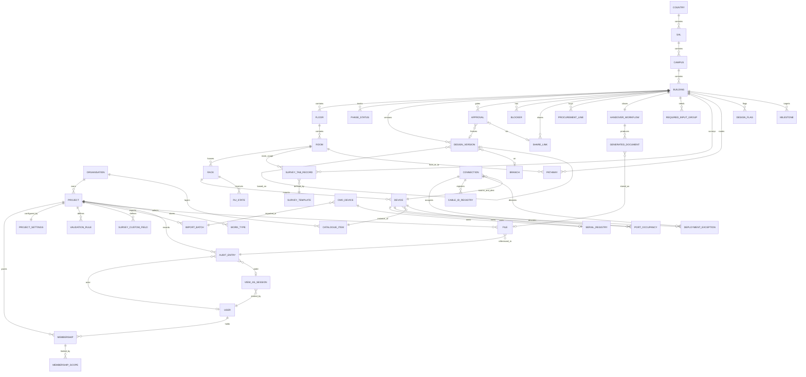

# Rackium data model (MongoDB + Mongoose)

Written for: the engineers building the backend. This is the contract the backend must satisfy. It is derived from the prototype's mock store (`client/src/mock/`, `client/src/api/`, `client/src/lib/`), the v2.3 brief (`docs/RACKIUM-BRIEF-v2.3.md`) and the client audit. It defines schema and rules. It contains no backend code.

**Source tags** on every entity or field group:

- **[M]** exists in the prototype's mock store; the shape comes from the code.
- **[B]** specified in the brief only, with no mock yet.
- **[C]** client audit addition, with no UI or mock yet.
- **[Dn]** a client decision from the decision review. Each is applied in the entity section where it lives. §12 maps each decision to its section.

---

## 0. Conventions

| Topic | Rule |
|---|---|
| Identifiers | `ObjectId` for every `_id`. References are `ObjectId` with `ref`. Human codes (`TR-EG-01`, `R01`, `E-DE-ERL-C01-B001-EG-001`, `PP-01`, cable IDs) are attributes, never `_id`. Readable seed IDs in the prototype (`b001-eg`, `dev-fusion`) are seed conventions only. |
| Dates | `Date`, stored in UTC. Date-only values (`dueDate`, `eolDate`, `warrantyEnd`) are stored as UTC midnight and displayed as the calendar date. |
| Enums | `String` with a Mongoose `enum` validator. Labels are UI concerns. |
| Money | `Number` in integer minor units, plus `currency` (ISO-4217) on the same document. |
| Embedding | Embed what is owned by one parent and read with it: connection hops, device installation, device DGUV, device lifecycle, device checklist, room survey facts, rack details, required-input entries, approval decision. Use a separate collection for anything with its own lifecycle or query path, or unbounded growth: audit entries, files, survey tab records, approvals, and the three registries. `Mixed` is avoided; survey field values carry a typed `value` (§5.4). |
| Case-insensitive uniqueness | Unique index with collation `{ locale: 'en', strength: 2 }`. Queries that rely on the index pass the same collation. Values are trimmed on write. |
| Transactions | Multi-document transactions need a replica set (Atlas or a replica set in development). Writes described as "same transaction" use a session. |
| Deletion | Soft delete (`deletedAt`) for customer data. The only hard delete is the GDPR organisation purge (brief §6.11), a resumable job. |

---

## 1. Tenancy and access

### 1.1 Scope fields

Every tenant document carries `organisationId` (ObjectId, required) and `projectId` (ObjectId, required), except the global collections in §1.3. The scope is denormalised onto every row so queries and indexes never need a join to find a tenant.

### 1.2 Tenant plugin (replaces row-level security)

One Mongoose plugin, `tenantScope`, is applied to every tenant model. It is the only route to tenant data.

- **Required scope.** A query without `organisationId` and `projectId` in the request context throws before reaching the database. Tenant models have no unscoped query path.
- **Organisation-level read** [F2]. A request carrying an organisation-level Org Admin context is scoped to `organisationId` only and may read any project in it. It may write project records only with a project-level membership.
- **Filter injection.** The plugin adds `{ organisationId, projectId }` to the filter of `find`, `findOne`, `findById`, `countDocuments`, `updateOne`, `updateMany`, `findOneAndUpdate`, `deleteOne` and `deleteMany`. For `aggregate`, it prepends a `$match` on the same fields.
- **Write checks.** On `save`, `insertMany` and `bulkWrite`, the plugin rejects a document whose scope differs from the request context.
- **Immutable scope.** `organisationId` and `projectId` cannot change on an existing document.
- **View-As is read-only.** In a View-As session (§1.6), the plugin rejects every write.
- **Audit is append-only.** Updates and deletes on `auditEntries` throw, except the GDPR purge job (§8.4).

### 1.3 Scope classes

| Class | Models | Scope |
|---|---|---|
| Tenant, project scope | Everything in §2 with `projectId`, including `memberships`, `invitations`, `viewAsSessions`, `projectSettings`, `validationRules` (project rules), `workTypes` (custom) | `organisationId` + `projectId` |
| Tenant, organisation scope | `organisations` (settings), `memberships` at organisation level, `validationRules` (organisation rules), `catalogueItems` in the `organisation` layer | `organisationId` |
| Global, platform-owned | `surveyTemplates`, `documentTypes`, `workTypes` (predefined), `catalogueItems` in `seeded` and `servon` layers | none. Read-only to customers. |
| Global, identity | `users` | none. A user can hold memberships in several organisations. |

### 1.4 Rackium Team — platform admin [D8]

- Rackium Team is an account type: `users.accountType = 'rackium_team'`. It sits **outside organisation tenancy** and has no membership.
- To read or write an organisation's data, a Rackium Team user opens a **platform context** naming the organisation and project. Only inside that context does the tenant plugin accept the scope.
- **Every access is audit-logged, reads included.** Each access writes an `auditEntries` document: `actor.type = 'rackium_team'`, `changeType = 'platform_access'`, the organisation and project, the collection, the operation, and a required `comment` holding the reason.
- A platform context cannot approve or submit through the normal UI. Any change it makes is audited like any other change.

### 1.5 Isolation tests (required before release)

Run in CI against a replica set, with two organisations of two projects each.

1. A query without scope throws, for every tenant model (generated, one test per model).
2. `findById` with a valid ID from another organisation returns nothing and does not reveal the ID exists.
3. `findById` with a valid ID from another project in the same organisation returns nothing.
4. An insert with a mismatched `organisationId` or `projectId` is rejected.
5. An aggregate without scope throws. An aggregate with scope cannot read another tenant.
6. Changing `organisationId` or `projectId` on an existing document is rejected.
7. A View-As session cannot write through any model.
8. An audit entry cannot be updated or deleted.
9. A Rackium Team read outside a platform context is rejected. Inside one, each operation writes exactly one platform-access audit entry.
10. Unique indexes reject duplicates within a project and allow the same value in another project (cable IDs, serials, hostnames).
11. Case-insensitive uniqueness: `cable-1` and `CABLE-1` collide inside a project and do not collide across projects.
12. An Org Admin without a project membership reads every project in the organisation and writes no project record.
13. The user who creates a project holds the PM membership for it, created in the same transaction.

### 1.6 Users, memberships, invitations and View As

**`users`** [C; brief §4.3]

- `email` (R, unique, case-insensitive) · `name` (R) · `accountType` (`customer` / `rackium_team`, R, default `customer`) · `status` (`invited` / `active` / `disabled`, R) · `lastLoginAt` (Date, O) · `mfaEnabled` (Boolean; required to be true for `org_admin`, `pm` and `architect`, brief §8.1) · `createdAt` (Date, R).
- No credentials on this document. Authentication is a separate concern (brief §8.1).

**`memberships`** [C; D5, F2] — two levels.

- `organisationId` (R) · `projectId` (O; **null for organisation level**) · `userId` (R) · `level` (`organisation` / `project`, R) · `role` (R; organisation level: `org_admin` or `member`; project level: `pm`, `architect`, `reviewer`, `external_reviewer` (M7b-1, §5.18), `field_engineer`, `viewer`) · `canCreateProjects` (Boolean, organisation level only, default false) · `invitedBy` (O) · `createdAt` (R) · `revokedAt` (O).
- **Organisation `member`** (M3a review): a non-admin organisation membership. It grants no policy action by itself and is never a policy role. It carries organisation-level permissions. Accepting a project invitation creates it when the user has no organisation membership yet. An Org Admin invitation accepted by a `member` upgrades that row to `org_admin`. The last-Org-Admin guard counts `org_admin` rows only.
- **Project creation** (M3a review, brief §4.3): an organisation-level permission, not a project role (`shared/policy.js` `canCreateProjects`).
  - An Org Admin always has it.
  - Anyone else needs `canCreateProjects = true` on their organisation membership.
  - A user who first joins the organisation as PM gets it by default, set only when the `member` row is created, so a later PM invitation cannot undo an Org Admin's revoke.
  - An Org Admin grants or revokes it for any member, audited as `membership.project_creation.granted` / `.revoked`.
  - The creator becomes the project's PM in the same transaction as the project (§10).
- **Organisation level** [F2]: Org Admin manages users, organisation settings and the catalogue, and has **read access to every project in the organisation**. An Org Admin has **no design approval rights** unless also given a project role.
- **Project level** [F2, D5]: PM, Architect, Reviewer, Field Engineer and Viewer. Memberships are per project. The embedded `scopes[]` (`{ type: 'country' | 'sal' | 'building', refId }`) limit the membership. **An empty `scopes` array means the whole project** [D5]. Scopes are additive.
- **Project creator** [F2]: the user who creates a project becomes its PM. The PM membership is created in the same transaction as the project (§10).
- A user may hold one organisation-level membership and any number of project-level memberships.
- Unique: `(organisationId, userId)` where `level = organisation` and `revokedAt` is null; `(projectId, userId)` where `level = project` and `revokedAt` is null.
- Brief §4.3 and §2.6: a Field Engineer scoped to one building sees only that building.

**Scope enforcement** (M3b review; one server helper, `server/src/access/scope.js`, used by every project route):

- A scoped member sees and acts only within their scope: dashboard (quick stats, blockers, recent activity, phase status), blockers (list, raise, update), CMO (inventory, KPIs, preview, import, assign), the project list and project home (buildings and progress), and the whole survey (structure, pathways, rack survey, forms, files).
- **Out of scope is 404**, indistinguishable from not there. Lists are filtered rather than refused.
- **The Org Admin is never limited**, even with a scoped project membership of their own. Unscoped project members and View As sessions see the whole project.
- Items in a building are in scope when the building is. **SAL-level items** (an Unassigned CMO device and its system blocker, which have no building yet) are in scope for SAL and country scopes covering that SAL, not for a building scope. A building-scoped member therefore does not see the SAL's Unassigned devices or their blockers on the dashboard, and their building's CMO status may still reflect them.
- CMO import by a scoped PM: rows for buildings outside the scope are blocked rows ("Building … is outside your scope"); rows without a building go to a SAL within the scope (a building-scoped importer has none, so those rows are blocked); naming a SAL outside the scope is refused.
- Raising a blocker requires a real building of the project in scope (earlier any id was accepted).

**`invitations`** [C]

- `organisationId` · `projectId` (R) · `email` (R, case-insensitive) · `role` (R) · `scopes[]` (as above) · `invitedBy` (R) · `tokenHash` (R, unique; SHA-256 of a 32-byte random token, as in §5.5) · `expiresAt` (Date, R) · `status` (`pending` / `accepted` / `expired` / `revoked`, R) · `acceptedAt` (Date, O).
- Accepting an invitation creates a membership. An expired or revoked invitation cannot be accepted.

**`viewAsSessions`** [C; brief-adjacent audit requirement]

- `organisationId` · `projectId` (R) · `actorUserId` (R) · `viewedRole` (R, one of the six roles) · `startedAt` (Date, R) · `endedAt` (Date, O).
- **View-as is view-only.** The plugin rejects writes in the session (§1.2). The actor's own role, not the viewed role, is what gets audited.
- Every start and end writes an audit entry (`view_as.started`, `view_as.ended`, `changeType = view_as_access`). Every audit entry created inside a session carries `viewAsSessionId`.
- The prototype's role switcher (`lib/RoleContext.jsx`) is client-side state with no user binding and no audit (§13).

---

## 2. Collections

| Collection | Purpose | Embeds | References | Unique indexes (case-insensitive where stated) |
|---|---|---|---|---|
| `organisations` | tenancy root, org settings | `settings` | — | `_id` |
| `users` | people and platform accounts | — | — | `email` |
| `memberships` | organisation-level and project-level roles | `scopes[]` | user, organisation, project | `(projectId, userId)` for project level; `(organisationId, userId)` for organisation level |
| `invitations` | pending access grants | `scopes[]` | project, inviter | `tokenHash` |
| `viewAsSessions` | view-only role switch | — | user, project | — |
| `projects` | project, active phases | `activePhases[]`, `workTypeIds[]` | organisation | `(organisationId, code)` |
| `projectSettings` | one per project | general, hierarchy, roles, naming, resource minutes, margin, cord override | project | `projectId` |
| `workTypes` | predefined (global) and custom (per project) work types | `phaseMapping[]` | project (custom) | `key` (predefined); `(projectId, name)` (custom) |
| `validationRules` | structured custom rules | — | project or organisation | — |
| `countries`, `sals`, `campuses` | hierarchy | — | parent | `(projectId, code)` |
| `buildings` | building and site size | — | campus | `(projectId, code)` |
| `wings` (optional) | §3.5 | — | building | `(buildingId, code)` |
| `floors` | floor and token | — | building, wing | `(buildingId, token)`, `(buildingId, order)` |
| `rooms` | room and survey facts | `survey` | floor, building | `(buildingId, code)` |
| `racks` | rack and survey facts | `details`, `mountingPower`, `cablePath`, `accessibility` | room, building | `(roomId, code)` |
| `devices` | network devices, patch panels, PDUs, cable managers, APs | `installation`, `dguv`, `lifecycle`, `portExceptions[]`, `provenance` | rack, room, building, catalogue key | `(projectId, hostname)` |
| `connections` | device-to-device links | `hops[]`, `lengths` | devices and ports | — (uniqueness through registries) |
| `pathways` | room-to-room routes [S5 rename] | — | rooms | `(projectId, roomLowId, roomHighId)` |
| `cableIdRegistry` | cable IDs and hop segment IDs | — | connection, hop | `(projectId, cableId)` |
| `portOccupancy` | which device port is in use | — | device, connection | `(projectId, deviceId, portId)` |
| `serialRegistry` | serials across CMO and devices | — | owner | `(projectId, serial)` |
| `ruStates` | reserved and blocked RUs [D1] | — | rack | `(projectId, rackId, ru, face)` |
| `catalogueItems` | layered catalogue | `portMap`, `mediaSpeed`, `stock` | organisation, project | `(layer, organisationId, projectId, kind, key)` |
| `importBatches` | CMO and lifecycle imports | — | uploader, file | — |
| `cmoDevices` | CMO inventory | — | batch, building, rack | via `serialRegistry` |
| `surveyTemplates` | 18-tab definitions, versioned, global | `tabs[]` | — | `(templateKey, version)` |
| `surveyTabRecords` | one per tab per building or room | `sections[]` (with `fieldValues`, `rows`) | building, room | `(projectId, buildingId, roomId, tab)` |
| `surveyCustomFields` | Org Admin fields per tab | — | project | `(projectId, tab, key)` |
| `designFlags` | e.g. survey changed after import [D2] | — | building | `(buildingId, kind, surveyTabRecordId)` |
| `phaseStatuses` | approval phases only | — | building | `(buildingId, phaseKey)` |
| `phaseTargets`, `milestones` | dates and SLA [C] | — | building | `(buildingId, phaseKey)` |
| `approvals` | one per gate | `decision`, `client` | design version, share link | — |
| `shareLinks` | client link, hashed token [D15] | `extensions[]` | building | `tokenHash` |
| `blockers` | human-raised blockers [C] | — | related object | — |
| `tasks` | assigned work [C] | — | users, related object | — |
| `notifications` | per-user alerts [C] | — | recipient | `(recipientId, readAt, createdAt)` |
| `notificationPreferences` | delivery settings [C] | — | user | `(userId, projectId, eventType, channel)` |
| `requiredInputGroups` | 12 groups per building | `addressingEntries[]`, `kvPairs[]` | building | `(buildingId, groupKey)` |
| `acceptedWarnings` | accepted validation warnings | — | building | — |
| `procurementLines` | serialised devices and consumables [D6] | — | building, device | `(buildingId, deviceId)` and `(buildingId, consumableKey)` |
| `designVersions` | HLD, LLD, SP, BOM versions | `changeSummaries[]` | building, branch, based-on version | `(buildingId, designType, number)` |
| `branches` | design branches | — | building, version | — |
| `handoverWorkflows` | one per building | `baseline` | building | `buildingId` |
| `generatedDocuments` | document outputs | — | building, file | — |
| `reportSchedules` | scheduled standard reports (M7a-3, §5.17) | `recipients[]` | users | — |
| `documentTypes` | the 11 handover types and SP sections | — | — | global seed |
| `deploymentExceptions` | install deviations | — | device, connection | — |
| `files` | photos, PDFs, sheets, signatures | — | attached object (polymorphic) | `storageKey` |
| `auditEntries` | one per user action [D10] | `changes[]` | actor, object | — (append-only) |

---

## 3. Hierarchy and project

### 3.1 Organisation [M `hierarchy.js` `organisation`] (brief §4.1)

| Field | Type | Req | Allowed / format | Default | § | Src |
|---|---|---|---|---|---|---|
| `name` | String | R | | | §4.1 | M |
| `defaultCurrency` | String | R | ISO-4217 | `EUR` | §5.6 | B |
| `settings.cordLengthDefaultM` | Number | R | > 0 | `2` | §6.7 | M (hard-coded) |
| `settings.timeZone` | String (IANA) | R | a valid IANA zone | `Europe/Berlin` | M5b review | — |
| `settings.digestTime` | String `HH:MM` | R | 24-hour, local | `07:00` | M5b review | — |
| `settings.cageNutsPerRu` | `{ front, rear }` Numbers | R | integers 0–20 | `{ 4, 4 }` | §5.6 (M5a review) | — |
| `settings.powerCordStandardDefault` | `{ label, connectorPair }` | O | [D16] | null | §6.7 | M shape |
| `settings.uploadLimitsMb` | `{ photo, pdf, sheet }` | R | [D12] configurable | `{ 15, 25, 10 }` | §5.2 | C |
| `settings.standardHeightsU` · `settings.customHeightsU` | `[Number]` | R / O | [§3.8] | `[12,24,42,45,48]` / `[]` | §4.1 | B |
| `settings.architectsSeePrices` | Boolean | R | Org Admin only; audited (`organisation.settings.updated`). When true, Architects also see catalogue prices and margins. The server strips prices for everyone else (`shared/policy.js` `canSeePrices`). | `false` | §4.3 | B (M3a review) |
| `deletedAt` · `gdprDeletionRequestedAt` | Date | O | soft delete, purge within 30 days | null | §6.11 | B |

### 3.2 Project [M `hierarchy.js` `project`] (brief §4.3: Org Admin, or a member holding `canCreateProjects` (§1.6), creates projects)

| Field | Type | Req | Allowed / format | Default | Src |
|---|---|---|---|---|---|
| `organisationId` | ObjectId | R | | | M |
| `name` | String | R | | seed `LANspire` | M |
| `code` | String | O | unique per organisation, case-insensitive | | C |
| `status` | String | R | `active` / `archived` | `active` | C |
| `workTypeIds` | `[ObjectId]` | O | refs `workTypes` (§3.10) [D4] | `[]` | C |
| `activePhases` | `[{ phaseKey, position }]` | R | ordered, non-empty subset of the nine phase keys; `position` unique | all nine, in order | C |
| `createdBy` · `createdAt` | ObjectId · Date | R | | | B |

**Phase gating** [D3] — the project's active phases in order define the sequence. **Pending client confirmation.** The default:

- A PM may **add** any phase that has not started.
- A phase **that contains data cannot be removed**. A phase contains data when its `phaseStatuses` row is not `not_started`, or when it owns any record (survey tab records, approvals, procurement lines, deployment exceptions).
- Progress, the sidebar and the dashboard use only active phases.
- Which phase blocks which, and whether an active phase may be skipped, follows the same order and waits on the same confirmation.

### 3.3 Country, SAL, Campus [M `hierarchy.js`] (brief §4.1)

- `countries`: `projectId` (R) · `code` (R, e.g. `DE`) · `name` (R, e.g. `Germany`). Unique `(projectId, code)`, case-insensitive.
- `sals`: `countryId` (R) · `projectId` (R) · `code` (R, e.g. `ERL`). Unique `(countryId, code)`. SAL-level devices (the Unassigned CMO list) hang here.
- `campuses`: `salId` (R) · `projectId` (R) · `code` (R, e.g. `C01`). Unique `(salId, code)`.

### 3.4 Building [M `hierarchy.js` `buildings[]`] (brief §4.1, §7.3)

| Field | Type | Req | Allowed / format | Default | § | Src |
|---|---|---|---|---|---|---|
| `campusId` · `projectId` · `organisationId` | ObjectId | R | | | | M / B |
| `code` | String | R | e.g. `B001`; unique per project, case-insensitive | | §4.1 | M |
| `name` | String | R | | | | M |
| `siteSize` | String | R | `S` (collapsed core). Other sizes are not defined in the brief, so only `S` is valid until they are. | `S` | §5.3 | M |
| `lastSyncAt` | — | C | max `auditEntries.occurredAt` for the building | | §7.3 | M (static) |

### 3.5 Wing (optional) [B §4.1]

`wings`: `buildingId` (R) · `code` (R) · `name` (R) · `order` (R). Unique `(buildingId, code)`. A floor may reference a wing. Not in the mock.

### 3.6 Floor [M `b001-site.js` `floors`] (brief §4.1, §6.6)

- `buildingId` (R) · `wingId` (O) · `token` (R; `FU1`, `EG`, `1.OG`, `2.OG`, `3.OG` by default, configurable per project) · `name` (R) · `order` (R, int ≥ 0).
- Unique `(buildingId, token)` and `(buildingId, order)`.
- The hostname form derives from `token` by removing dots and spaces (`1.OG` → `1OG`). See §7.

### 3.7 Room [M `b001-site.js` `rooms`, `roomSurveyMeta.js`] (brief §5.2)

- `floorId` (R) · `buildingId` (R, denormalised) · `projectId` (R) · `code` (R, e.g. `TR-EG-01`, `UG1705`; unique per building, case-insensitive) · `name` (O, defaults to `code`) · `isMainRoom` (R, default `false`).
- Embedded `survey` (M `roomSurveyMeta`): `access` (`verified` / `not_verified`, default `not_verified`), `power` (`available` / `unknown`, default `unknown`), `environment` (`verified` / `to_verify` / `unknown`, default `unknown`).
- Photo count is **computed** from `files` attached to the room (§6). The mock stores it as a counter, which the backend must not do.

### 3.8 Rack [M `b001-site.js` `racks`, `rackSurveyMeta.js`] (brief §4.1)

- `roomId` (R) · `buildingId` (R) · `projectId` (R) · `code` (R, e.g. `R01`; unique per room, case-insensitive) · `heightU` (R, int).
- **`heightU` allowed values:** 12, 24, 42, 45, 48, or a custom height defined by the Org Admin (for example 23U from the Siemens survey, §4.1). Allowed = `standardHeightsU ∪ customHeightsU` from organisation settings. Default 42.
- Embedded `details`: `type` (`floor_standing`), `standard` (`19-inch`), `externalDepthMm`, `usableDepthMm`, `railDistanceMm`, `condition` (`good`; further values open), `frontClearanceMm`, `rearClearanceMm`.
- Embedded `mountingPower`: `cageNutType` (String, e.g. `M6`), `availableCageNutSets` (Number ≥ 0), `mountingRails` (String), `redundantPower` (`available` / `not_available`), `earthingVerified` (Boolean), `pduA` and `pduB` (`{ totalSockets, freeSockets }`, Numbers ≥ 0).
- Embedded `cablePath`: `mainCableEntry`, `pathway`, `secondaryEntry` (Strings), `verticalManagers`, `horizontalManagers` (Numbers ≥ 0).
- Embedded `accessibility`: `front`, `rear`, `left`, `right` (`accessible` / `not_accessible`).
- Reserved and blocked RUs are not on the rack. See §4.2.

**As built in M3b (rooms, racks, rack survey; supersedes the points above where they differ):**

- Room `survey` also takes `power: not_available` and `environment: issue` (the prototype's room panel offers both), plus `updatedAt` / `updatedBy`. Photo count is computed from `files`.
- Rack facts (`details`, `mountingPower`, `cablePath`, `accessibility`) are stored as validated sub-documents (Mixed, shape checked by `rackFactsBody`); `frontClearanceMm` / `rearClearanceMm` sit under `accessibility`, as the prototype shows them. Editing facts is `EDIT_SITE_STRUCTURE` (Org Admin, PM, Architect, Field Engineer).
- Rack revisions live on the rack as `surveyRevision` `{ revision, savedAt, savedBy, autosavedAt }` instead of a separate `rackRevisions` collection (§5.6): one row per rack either way, and it saves a join. Autosave sets `autosavedAt` only; Save Version increments `revision`.
- Existing devices placed in the Rack Survey are `devices` rows (`origin = existing`) with the placement fields `ru` (null for 0U), `heightU`, `face`, `fullDepth`, `mounting` (`rack` / `0U`), `railSide`, `category`, `label`, `sublabel`. A newly placed item's id is chosen by the client (24-hex, like file ids) so autosave and undo keep addressing the same device. Removing gear unplaces identified devices (CMO or with a serial) and deletes anonymous library items.
- Placement validation re-runs `shared/rackValidation.js` server-side (overlap per face, full-depth, boundary, height) against every other placement and the active RU states. Serials and MACs go through the project registry; an imported CMO device's serial cannot be changed from the rack; an omitted serial/MAC keeps the stored one.
- **Existing label / name (fix/cmo-naming-gaps):** each surveyed item may carry `existingLabel`, the name or label on it on site (free text, no naming pattern; omitted on save = keep, null or empty = clear). It is shown wherever surveyed items are listed — the survey's elevation, the HLD and LLD views, the Rackium Editor and schedules, deployment and CMDB — instead of the library name; `label` keeps what was placed. Picking a CMO device (by its serial, or from the CMO list, which also lists devices without a serial) pre-fills it from the CMO hostname and keeps the placed item's label.
- A CMO device imported with a rack and RU but no height shows as 1U until surveyed; one imported with a rack but no RU is not drawn and is not unplaced by a save — it stays in the rack's CMO list until it is placed.
- The readiness summary is calculated on read (`shared/rackReadiness.js`), never stored.
- Floors, rooms and racks are created by Org Admin, PM, Architect and Field Engineer (`EDIT_SITE_STRUCTURE`), within the caller's membership scopes. There is no separate "structure verified" state: the Architect verifies the structure through the survey tabs (§5.4), which carry the rooms and racks (Comms Rooms Summary, Rack Layout).

### 3.9 Project settings [M partial `projectSettings.js`, `powerStandards.js`; C rest]

One document per project (`projectSettings`). Changes are audited (`settings.updated`).

- **General:** `timezone` (IANA name), `units` (`metric`), `currency` (defaults to the organisation's; ISO-4217).
- **Hierarchy:** `wingEnabled` (Boolean, default false, §3.5), `floorTokens` (`[{ floorOrder, token }]`, defaults from §3.6).
- **Device roles:** `roleCodes` `{ fusion: 'F', border: 'B', distribution: 'D', edge: 'E', ap: 'A', wan_circuit: 'W' }` (role codes per §6.6; `W` is a proposal for `wan_circuit`, flagged in §13).
- **Connection types:** `allowedMedia` (`[os2, om4, cat6a, stack, dac]`), `allowedSpeeds` (`[1G, 10G, 40G]`).
- **Naming:** `hostnamePattern` (default `{role}-{country}-{sal}-{campus}-{building}-{floor}-{seq}`), `sequencePadding` (Number, default 3). Changes apply to new records only (§7).
- **Survey:** `surveyTemplateVersion` (Number, refs `surveyTemplates.version`).
- **Built-in rules:** `builtInRules` `[{ key, enabled, severity }]` — toggles and severity for the code-defined validators (`lib/validation.js`, `lib/siteValidation.js`).
- **Resource standards:** `resourceMinutes` `[{ taskKey, minutes }]`, seeded from `billOfResources.js` `RESOURCE_TASKS` `defaultMinutes`. Brief §5.5: PM sets these.
- **Commercial:** `marginPercent` (Number, default 15, PM-editable, §5.6).
- **Power cord:** `powerCordStandardOverride` (`{ label, connectorPair }` or null) [D16]. See §4.9.

### 3.10 Work types [D4, F1]

`workTypes` holds the predefined types (global) and custom types (per project).

- `key` (R, stable, never changes once issued; unique among predefined rows) · `name` (R) · `isPredefined` (Boolean, R) · `organisationId` (null for predefined) · `projectId` (null for predefined; set for custom) · `phaseMapping` (`[phaseKey]`, default empty; **pending client confirmation** [D4]) · `createdBy` · `createdAt`.
- Unique `(projectId, name)` for custom types, case-insensitive. Predefined keys are unique globally.
- A project selects work types through `projects.workTypeIds`; it may select several.
- **Custom type** [F1]: free text, entered per project. It is a `workTypes` row with `isPredefined = false` and `projectId` set.

**Predefined work types** (28):

| # | Name | Key |
|---|---|---|
| 1 | Wireless Site Survey | `wireless_site_survey` |
| 2 | Wireless Network Design (HLD/LLD) | `wireless_network_design` |
| 3 | Wireless Network Installation & Commissioning | `wireless_installation_commissioning` |
| 4 | Wired Network Site Survey | `wired_site_survey` |
| 5 | Wired Network Design (HLD/LLD) | `wired_network_design` |
| 6 | Wired Network Installation & Commissioning | `wired_installation_commissioning` |
| 7 | Rack & Stack (Server/Switch/Storage mounting) | `rack_and_stack` |
| 8 | Structured Cabling Installation (Cat6/Cat6A/Fibre) | `structured_cabling_installation` |
| 9 | Fibre Optic Installation & Splicing | `fibre_installation_splicing` |
| 10 | Patch Panel Termination & Testing | `patch_panel_termination_testing` |
| 11 | Cable Pathway & Containment Installation | `cable_pathway_containment` |
| 12 | Data Centre Fit-Out | `data_centre_fit_out` |
| 13 | Server Room Build / Refurbishment | `server_room_build_refurb` |
| 14 | ITAD (IT Asset Disposition / Decommission) | `itad` |
| 15 | Site Decommission (Full teardown) | `site_decommission` |
| 16 | Network Audit / CMDB Reconciliation | `network_audit_cmdb_reconciliation` |
| 17 | Physical Site Survey Only (no design) | `physical_site_survey_only` |
| 18 | CCTV / IP Camera Installation | `cctv_ip_camera_installation` |
| 19 | Access Control System Installation | `access_control_installation` |
| 20 | UPS / Power Distribution Installation | `ups_power_distribution_installation` |
| 21 | Environmental Monitoring (sensors, DCIM) | `environmental_monitoring` |
| 22 | Hardware Break-Fix / IMAC (Install, Move, Add, Change) | `hardware_break_fix_imac` |
| 23 | Firewall / Security Appliance Deployment | `firewall_appliance_deployment` |
| 24 | Smart Hands / Remote Hands Support | `smart_hands_remote_hands` |
| 25 | Cable Certification & Testing (Fluke) | `cable_certification_testing` |
| 26 | Desktop / Endpoint Rollout | `desktop_endpoint_rollout` |
| 27 | AV / Conference Room Setup | `av_conference_room_setup` |
| 28 | Edge / MDF / IDF Room Setup | `edge_mdf_idf_room_setup` |

**Presets** [F1] — a global seed that sets `projects.activePhases`; the PM may edit the result:

- **Full Network Deployment:** all nine phases in order (`cmo`, `survey`, `hld`, `lld`, `solution-package`, `bom`, `deployment`, `cmdb`, `handover`).
- **Survey & Design Only:** `cmo`, `survey`, `hld`, `lld`, `solution-package`.

Until the per-work-type phase mapping is confirmed (§11, item 1), the PM picks active phases manually or through a preset.

### 3.11 Custom validation rules [M none; C; D11]

`validationRules` — a **structured builder** with no expression language [D11].

- `name` (R) · `object` (R; allowlist: `device`, `connection`, `pathway`, `rack`, `room`, `surveyTabRecord`, `procurementLine`) · `field` (R; must be in the object's field allowlist, checked on save) · `operator` (R; `eq`, `neq`, `empty`, `notEmpty`, `gt`, `gte`, `lt`, `lte`, `in`, `notIn`) · `value` (typed by the field: stored as `valueString`, `valueNumber`, `valueBoolean` or `valueList`; absent for `empty` and `notEmpty`) · `severity` (R; `info` / `warning` / `error` / `blocking`) · `enabled` (Boolean, default true) · `scope` (`organisation` or `project`) · `projectId` (null for organisation rules).
- **Who authors** [D11]: Org Admin authors organisation rules (`scope = organisation`). Architect authors project rules (`scope = project`).
- One condition per rule. Combining conditions is done by writing more rules.
- A `blocking` finding stops the action it guards (for example submitting a survey tab or approving a design). Other severities are displayed.
- Built-in rules stay in code and are toggled through `projectSettings.builtInRules`.

---

## 4. Devices, connections, catalogue and registries

### 4.1 Device [M `b001-site.js` `devices`, `networkStore.js`] (brief §4.1, §6.5, §5.7, §5.8)

One collection holds every physical item in a rack or room: network devices, patch panels, PDUs, cable managers, APs and WAN circuits. Rack Survey writes here [D1].

| Field | Type | Req | Allowed / format | Default | § | Src |
|---|---|---|---|---|---|---|
| `projectId` · `buildingId` · `organisationId` | ObjectId | R | | | | M / B |
| `origin` | String | R | [D1] `existing` (surveyed on site) or `planned` (designed in HLD and LLD) | `planned` | §5.2, §5.4 | B |
| `hostname` | String | R | §7 pattern; unique per project, case-insensitive | generated once | §6.6 | M |
| `role` | String | R | `fusion`, `border`, `distribution`, `edge`, `ap`, `wan_circuit` (the mock uses `wan-circuit`; underscore in the database) | | §4.1, §6.6 | M |
| `category` | String | R | `network_device`, `patch_panel`, `pdu`, `ups`, `server`, `probe`, `cable_management`, `accessory`, `wan_circuit` | `network_device` | §6.5 | M partial |
| `model` | String | R | must match a `catalogueItems` device key | | §6.5 | M |
| `existingLabel` | String | O | surveyed (`existing`) gear only: the name or label recorded on site, as the customer uses it (fix/cmo-naming-gaps). Free text, ≤ 120 characters, no naming pattern (v2.2 §20.10). Shown instead of `label` (which keeps what was placed: kind and port count) — `shared/deviceName.js` `deviceDisplayName`: existing label, else hostname, else label, else model | null | §5.2 | B |
| `vendor` | String | O | from the CMO import's vendor column (v2.2 §3.5a) | null | §5.1 | B |
| `floorId` | ObjectId | O | from the CMO import's floor column, checked against the building's floors; a device's floor is otherwise its room's | null | §5.1 | B |
| `rackId` | ObjectId | O | null when not racked (e.g. ceiling APs) | null | §4.1 | M |
| `ru` | Number | O | ≥ 1 when racked; null for 0U and unracked | null | §4.1 | M |
| `heightU` | Number | R | ≥ 0; 0 for 0U vertical PDUs | catalogue value | §4.1 | M |
| `face` | String | R when racked | `front` / `rear` | `front` | §4.1 | M |
| `fullDepth` | Boolean | R | occupies both faces when true | false | §4.1 | B |
| `railSide` | String | O | `left` / `right`, 0U only | | §4.1 | M |
| `status` | String | R | §5.2 (includes `maintenance`, `retired`) | `planned` | §4.4 | M / B |
| `installation` | embedded | O | §4.1a | | §5.7 | M |
| `dguv` | embedded | O | §4.1b [D13] | | §6.9 | M / C |
| `lifecycle` | embedded | O | §4.1c [D14] | | §6.5 | C |
| `portExceptions` | `[{ portId, reason, note, createdBy, createdAt }]` | O | pre-occupied and other exceptions [S4] | `[]` | §6.8 | M |
| `provenance` | `{ [field]: { source, setBy, setAt, importBatchId } }` | O | §8.2 | `{}` | §5.8 | C |

**Placement rule** [D1]: for `origin = planned`, the Rack Survey may record placement before LLD approval. After LLD approval, a placement change goes through a change request (§5.9). This is a default pending confirmation (§11, item 6).

**§4.1a `installation`** (embedded, M `deploymentDesign.js`)

- `serial` (String, O; unique through `serialRegistry`, §4.4) · `mac` (String, O; normalised; unique per project through `devices (projectId, installation.mac)` sparse).
- `confirmedRu` (Number) · `pduOutlet` (String) · `location` `{ latitude, longitude, altitude }` (Numbers; WGS84).
- `technicianId` (ObjectId, O). The mock stores a name string.
- `installedAt` (Date).
- `checklist` (embedded): `rackRu`, `labelled`, `power`, `patched`, `tested`, `dguv` (Booleans). The mock's kebab-case keys (`rack-ru`) become camelCase.
- `serialValidation` is **not stored**. It is computed from `serialRegistry` and CMO (§6).
- `evidenceCount` is **not stored**. It is counted from `files` with `category = evidence` (§6).

**§4.1b `dguv`** (embedded) [D13]

- `lastInspectionAt` (Date) — **required** to record an inspection.
- `inspectorName` (String) — **required** with the inspection date.
- `certificateFileId` (ObjectId → `files`) — optional.
- `status` and `nextDueAt` are **calculated** from `lastInspectionAt` (48-month interval, brief §6.9). Not stored.

**§4.1c `lifecycle`** (embedded) [D14]

- `warrantyStart` · `warrantyEnd` · `plannedRefreshAt` (Date, O).
- `source` (`manual` / `import`) · `importBatchId` (ObjectId, O, set on import).
- Entered manually by PM or Architect, or imported from Excel or CSV by PM or Architect (§4.6). Warranty status is calculated from `warrantyEnd`.

**Ports are not stored as rows** [S4]. A device's port list comes from the catalogue item's `portMap`. The database stores only occupancy (`portOccupancy`, §4.3) and exceptions (`portExceptions`, above).

### 4.2 RU state [B §4.1] [D1] — `ruStates`

Reserved and blocked space is separate from devices [D1].

- `rackId` (R) · `ru` (Number, R) · `face` (`front` / `rear` / `both`, R) · `state` (`reserved` / `blocked`, R) · `reason` (String, O) · `setBy` (ObjectId, R) · `setByRole` (R) · `setAt` (Date, R) · `releasedAt` (Date, O).
- Rules (brief §4.1): `reserved` is set and released by the **Architect**. `blocked` is set by **PM or Org Admin**, and the Architect cannot override it.
- Unique `(projectId, rackId, ru, face)` for active rows.
- The Rack Survey's "Reserved for FMO" rows become `ruStates` rows.

### 4.3 Connection, hops and port occupancy [M `networkStore.js` `connections`] (brief §6.2, §5.8) [S3, S4, D7]

**Connection** — a device-to-device link. The room-to-room route is a pathway (§4.5).

| Field | Type | Req | Allowed / format | Default | § | Src |
|---|---|---|---|---|---|---|
| `projectId` · `organisationId` · `buildingId` | ObjectId | R | | | | B |
| `source` · `dest` | `{ deviceId, portId }` | R | | | §6.2 | M |
| `media` | String | R | `os2`, `om4`, `cat6a`, `stack`, `dac`. `power` and `planned` are display categories, not media [D7]. | | §6.2 | M |
| `speed` | String | R | `1G`, `10G`, `40G` | | §6.4 | M |
| `sourceSfpCode` · `destSfpCode` | String | O | must match catalogue media and speed (§6.4); null for `cat6a` and `dac` | null | §6.4 | M |
| `cableId` | String | O until LLD approval, then R | 1–32 characters; registered in `cableIdRegistry` (§4.4) | null | §6.1 | M |
| `hops` | `[Hop]` | O | ordered | `[]` | §6.2 | M (always empty in seed) |
| `lengths` | `{ suggestedM, engineerSelectedM, installedM }` | O | > 0 each; `engineerSelectedM` null = use suggested | | §6.3 | M |
| `status` | String | R | §5.3 | `designed` | §4.4 | M |
| `testResult` | String | O | `pass` / `fail` | null | §6.2 | M |

**Hop** (embedded in `connections.hops`) [B §6.2]

- `seq` (Number, contiguous from 1 within the connection) · `patchPanelId` (ObjectId → devices) · `inPort` · `outPort` (Strings, must exist in the patch panel's port map) · `roomId` · `rackId` (ObjectIds) · `ru` (Number) · `segmentCableId` (String, O) · `lengths.engineerSelectedM` · `lengths.installedM` (Numbers, O; M5a review).
- **Route segments (M5a review).** A route source → hop panels → destination is one physical cable per pair of neighbouring nodes. Segment 0 (source → first panel, or → destination when direct) carries the connection's own `cableId` and `lengths`; segment k ≥ 1 (hop k's panel → next node) carries hop k's `segmentCableId` and `lengths`. Device↔panel is a **patch cord**, panel↔panel a **trunk**, device↔device **direct**. Suggested is calculated per segment (`shared/cableSegments.js`).
- Each `segmentCableId` is registered in `cableIdRegistry`, and each of `inPort` and `outPort` is registered in `portOccupancy`, in the same transaction (§10).

**Port occupancy** — `portOccupancy` [S3, S4]

- `projectId` (R) · `deviceId` (R) · `portId` (String, R) · `connectionId` (R) · `hopSeq` (Number, O) · `source` (`connection` / `hop` / `pre_occupied`, R).
- Unique `(projectId, deviceId, portId)`. This one index is the port-assignment guarantee.
- A decommissioned connection removes its occupancy rows in the same transaction (§5.3).
- A pre-occupied port is written here with `source = pre_occupied` **and** recorded as a `portExceptions` entry on the device. The occupancy row enforces uniqueness; the exception explains why.

### 4.4 Registries [S3]

Three collections enforce uniqueness across a project. Each row is written in **the same transaction** as the document that owns it. A duplicate-key error aborts the transaction and returns a conflict.

| Registry | Fields | Unique index | Written with |
|---|---|---|---|
| `cableIdRegistry` | `projectId`, `cableId` (trimmed), `ownerType` (`connection` / `hop`), `connectionId`, `hopSeq` (O), `status` (`reserved` / `retired`), `reservedAt` | `(projectId, cableId)`, case-insensitive | connection create or update, cable ID assignment, hop insert or change, decommission (sets `retired`; never deletes or reuses; [F4]) |
| `portOccupancy` | §4.3 | `(projectId, deviceId, portId)` | connection create, update or decommission; hop insert; pre-occupied exception |
| `serialRegistry` | `projectId`, `serial` (trimmed), `ownerType` (`cmoDevice` / `device`), `ownerId` | `(projectId, serial)`, case-insensitive | CMO import commit, serial entry on a device, device replacement |

A cable ID and a hop segment ID share one namespace (brief §6.1). Both sit in `cableIdRegistry`, and `ownerType` tells them apart.

### 4.5 Pathway (room-to-room route) [M `siteStructure.js` `connections`] [S5 rename]

Renamed from "building connection". Device links keep the name *connection*.

- `projectId` · `buildingId` (R) · `roomLowId` · `roomHighId` (ObjectIds, R; the smaller ID is stored first so the pair is unordered) · `routeStatus` (`surveyed` / `estimated`, R) · `distanceM` (Number, O, > 0) · `fileIds` (ObjectIds → `files`, O) · `createdBy` · `createdAt`.
- Unique `(projectId, roomLowId, roomHighId)`. Rooms may sit in different buildings (brief §5.2).
- The mock's `fromRoomId` and `toRoomId` become the normalised pair. A route has no meaningful direction.

**As built in M3b:** `buildingIds` (`[ObjectId]`, one or two) replaces the single `buildingId`, so a cross-building route is listed and audited under both buildings. Evidence photos are `files` attached to the pathway (no `fileIds` array). `updatedBy` / `updatedAt` are kept. The API returns pathways in the `{ fromRoomId, toRoomId, routeStatus, distanceM }` shape `shared/pathway.js` and `shared/cableLength.js` take. A room with pathways cannot be deleted.

**RU states as built in M3b (§4.2):** a released state keeps its row (`releasedAt`, `releasedBy`); only active rows block rack deletion. Setting a state over an occupied RU is refused (409).

### 4.6 CMO, lifecycle imports and import batches [M `cmoDesign.js`] (brief §5.1)

**`importBatches`**: `projectId` (R) · `type` (`cmo` / `lifecycle`, R) · `uploadedBy` (R) · `uploadedAt` (Date, R) · `sourceFileId` (ObjectId → `files`, R) · `rowCount` (Number, R) · `status` (`previewed` / `committed` / `rejected`, R) · `summary` (embedded counts by outcome).

**`cmoDevices`**: `projectId` · `importBatchId` (R) · `hostname` (O) · `model` (O) · `serial` (R, through `serialRegistry`) · `mac` (O, normalised) · `salId` (R) · `buildingId` (O; null = Unassigned at SAL level, §5.1) · `roomId` · `rackId` (O) · `ru` (Number, O) · `assignedBy` (O) · `assignedAt` (Date, O).

- `roomCode` and `rackCode` are **not stored** on the device [§13.1]. They are read from `rooms.code` and `racks.code`.
- Commit is one transaction per batch: every valid row is written with its registry entry, or none is (§10).
- Each unassigned CMO device counts as an open blocker. This is calculated (§6).
- Lifecycle imports [D14] use the same batch model, with `type = lifecycle`, and write `devices.lifecycle`.

**As built in M3a (client instruction, supersedes the two points above where they differ):**

- Imported CMO devices are rows in `devices` with `origin = existing` and `status = in_service` [F5], not a separate `cmoDevices` collection. `devices.salId` is required. `devices.buildingId` is null while a device is Unassigned. `role`, `category`, `model` and placement are optional for existing devices. `catalogueKey` is set when the CMO model text matches a catalogue item.
- Each Unassigned device raises one `blockers` row (`source = system`, `relatedObjectType = device`, `salId` set, `buildingId` null), written in the import transaction. Assigning the device resolves that row in the same transaction, and these rows cannot be resolved by hand. This replaces the "calculated, not rows" rule in §5.10 for CMO only.
- The CMO phase status is computed and never stored. It is Not started until the building has imported devices, Blocked while its SAL still has Unassigned devices, and Completed after that.
- The file is parsed in the browser and posted as mapped rows, and `importBatches.sourceFileId` waits for the `files` collection (§9). The batch keeps `fileName`.

**As built in fix/cmo-naming-gaps (v2.2 §3.5a; supersedes the points above where they differ):**

- **Names are the customer's own.** `hostname` stores the CMO name exactly as imported; no naming pattern is applied to imported or surveyed gear (FMO naming applies to planned devices only).
- **Serial is optional.** A row without a serial is imported and marked "No serial" (warning `no_serial`): no `serialRegistry` entry, so it cannot be serial-validated in the survey, but it can be picked from the CMO list in the Rack Survey. Serial, MAC and hostname duplicate checks still apply when the value is present. A row with none of hostname, serial, MAC or model is blocked (`no_identity`). The batch summary counts `noSerial`; the KPIs too.
- **Vendor:** an optional column (header aliases include vendor, manufacturer, hersteller, make, brand), stored as `devices.vendor`.
- **Floor:** the floor column is stored as `devices.floorId`, matched against the building's floors by token (also its hostname form, `1OG` for `1.OG`) or name, case-insensitively — the same rules as room and rack: checked only with a known building; unknown is a warning (`unknown_floor`, imported without a floor); with a floor, a room on another floor is left out (`room_not_on_floor`), as a rack outside its room is. The CMO table shows the floor (the stored one, else the room's).
- The import preview shows Vendor, Model, Serial ("No serial"), Floor and the server's own refusal text (e.g. a building outside the importer's scope).
- Not built (waiting on the client): a mapping from a CMO item to the FMO item that replaces it, the ghost overlay, and CMO/FMO terminology changes.

### 4.7 Device catalogue, optics and stock cable [M `deviceCatalogue.js`, `sfpCatalog.js`] (brief §6.3–§6.5, D19, D27, D35, D36)

`catalogueItems`, layered (§4.8):

| Field | Type | Req | Allowed / format | Default | Src |
|---|---|---|---|---|---|
| `layer` | String | R | `seeded`, `servon`, `organisation`, `project` | | C |
| `organisationId` · `projectId` | ObjectId | O | null for `seeded` and `servon`; set for the lower layers | null | C |
| `kind` | String | R | `device_model`, `optic`, `stock_cable`, `consumable` | | C |
| `key` | String | R | model string, optic code, media-length key or consumable key; unique per layer and kind, case-insensitive | | M |
| `category` | String | R | §4.8 | | C |
| `vendor` | String | O | | `Cisco` | M |
| `unitPriceMinor` | Number | R | integer minor units | | M (decimal) |
| `currency` | String | R | ISO-4217 | organisation default | M (constant) |
| `eosDate` · `eolDate` | Date | O | | | C |
| `servonAvailable` · `servonProductCode` | Boolean · String | O | manual flag, no sync [D35] | false | M / B |
| `rackMounted` · `heightU` · `psuCount` · `powerInletType` · `needsUplinkModule` | — | R for `device_model` | | | M (except `heightU`: C) |
| `portMap` | `{ count, type, namingPattern }` | O | the source of truth for a device's port IDs (§4.1) | | M implicit / C |
| `mediaSpeed` | `{ media, speed, reachM }` | R for `optic` | the reach check of §6.4 | | M |
| `stock` | `{ media, lengthM, pricePerMetreMinor }` | R for `stock_cable` | §6.3, D27 | | B |

- **Serialised vs consumable** [F6]: serialised = `switch`, `router`, `firewall`, `ap`, `wlc`, `server`, `ups`, `pdu`, `probe` (§4.10). Everything else in §4.10's consumable list is a consumable.
- The mock's three device models and two optics seed the `seeded` layer until Technonex supplies the full 20–30 model list (brief §6.5).

**As built in M3a:**

- **Storage.** The `seeded` and `servon` layers live in `platformCatalogueItems`, which is global and has no tenant plugin. The `organisation` and `project` layers live in `catalogueItems`, which is organisation-scoped through the tenant plugin. Customer data therefore never sits outside the plugin.
- **Fields added.** `fullDepth`, `mounting` (`front` / `rear` / `0U`), `weightKg`, `powerDrawW`, `poeBudgetW`, `compatibleSfps`, `compatiblePsus`, `compatibleModules` and `artworkFront` / `artworkRear` (a reference only). `key` is `vendor + ' ' + model`.
- **Port map.** `portMap` is `{ groups: [{ role: access|uplink|module, type, speed, poe, count, start, pattern }] }`. The pattern uses `{n}`, or `{n:2}` to zero-pad. Groups expand to exact sequential IDs, and duplicates are rejected.
- **Price.** `unitPriceMinor` is optional. Null means not priced.
- **Seed.** The seed is placeholder data (`placeholder = true`) and is inserted only where missing.
- **Price visibility.** Prices are removed server-side unless the caller holds a role that may see them (§4.3).
- **Not built yet.** Nothing writes the `servon` layer (Rackium Team tooling), and nothing writes the `project` layer (no UI or route). Both are read and resolved already.

### 4.8 Catalogue layers and categories [C]

- **Layers:** `seeded` (Rackium Team, global) → `servon` (platform product codes, global) → `organisation` → `project`. For any key, the highest layer that defines it wins. A lower layer never removes a key; it overrides values only.
- **Categories:** passive (`cable`, `patch_panel`, `cabinet`, `cage_nut`, `accessory`, `cable_management`); active networking (`switch`, `router`, `firewall`, `ap`, `wlc`); `server`; `probe`; infrastructure (`ups`, `pdu`, `sensor`); external (`wan_sp_connection`, `remote_site`).
- Power and planned are display categories for cables (D7), not catalogue categories.

### 4.9 Power cord standard [D16]

- `organisations.settings.powerCordStandardDefault` (organisation default) and `projectSettings.powerCordStandardOverride` (project override, nullable). Both hold `{ label, connectorPair }`.
- Resolution order for a device's cord: project override → organisation default → country plug table (brief §6.7). Default cord length comes from `organisations.settings.cordLengthDefaultM`.

### 4.10 Procurement lines [M `bomDesign.js` `procurementOverrides`; C shape] (brief §5.6) [D6]

BOM **lines are computed** from the design (§6). Only procurement facts are stored, in two shapes:

**Serialised line** — one per device, for categories `switch`, `router`, `firewall`, `ap`, `wlc`, `server`, `ups`, `pdu`, `probe` [F6]. Serialised items carry DGUV, which is tracked per device (§4.1b):

- `lineType = 'serialised'` · `deviceId` (R) · `procurementStatus` (`not_ordered` / `ordered` / `shipped` / `delivered`, R, default `not_ordered`).
- Unique `(buildingId, deviceId)`.
- `ordered` on a serialised line moves the device to `ordered` (§5.2). `delivered` moves it to `delivered`.

**Consumable line** — one per consumable type [F6]. Consumable types: patch cords and cables by media and length, SFPs and optics, DAC and stack cables, power cords, cage-nut sets, patch panels, cable managers, blanking and brush panels, shelves, labels. Patch panels are devices in §4.1 but are procured as consumables; their device status is set by Deployment, not by procurement:

- `lineType = 'consumable'` · `consumableKey` (R, a catalogue key of kind `optic`, `stock_cable`, `consumable`) · `orderedQty` (Number ≥ 0, R) · `deliveredQty` (Number ≥ 0, R).
- Unique `(buildingId, consumableKey)`.
- Consumable status is **calculated**: `not_ordered` when `orderedQty = 0`, `delivered` when `deliveredQty ≥ orderedQty`, otherwise `partial`. Not stored (§6).

**Both shapes** — `vendor` (String, O) · `poNumber` (String, O) · `expectedDelivery` · `actualDelivery` (Date, O) · `notes` (String, O) · `updatedBy` (R) · `updatedAt` (Date, R) · `version` (Number, R, optimistic concurrency).

- Procurement unlocks only after Solution Package approval, and is read-only after handover acceptance (brief §5.6).
- Corrections after `delivered` are PM edits, audited (§8.1). No reverse transitions are enforced.
- Consumable types are as listed above [F6].

### 4.11 Deployment exceptions [M `deploymentDesign.js` `exceptionsByBuilding`] (brief §5.7, §5.9)

`deploymentExceptions`: `projectId` · `buildingId` (R) · `deviceId` (R) · `connectionId` (O) · `field` (R; `media`, `sfp`, `port`, `ru`, `cable_id`, `rack_ru`, `length`) · `label` (R) · `designedValue` · `installedValue` (String, R) · `reason` (String, R) · `resolved` (Boolean, R, default false) · `resolutionNote` (String, O; required to resolve, feeds the exception register) · `resolvedBy` · `resolvedAt` (O) · `loggedAt` (Date, R).

- `hasPhoto` is **computed** from `files` attached to the exception (§6), not stored.

**As built (M6a):** `field` is the detected field (`rack`, `ru`, `face` on a device; `source_port`, `dest_port`, `media`, `source_sfp`, `dest_sfp`, `cable_id:<segment>`, `length:<segment>` on a connection — shared/deployment.js). `designedValue` and `installedValue` are copied from the detection, never typed. `photoFileIds` (ObjectId[], O) — photos uploaded to the device. `resolved`/`resolutionNote` became a `status`: `open` → `accepted` | `rejected` (Reviewer or PM; a note is required to reject) — and, when the installation is saved again, `corrected` (the difference is gone) or `superseded` (a different installed value; the old record no longer describes it). `loggedBy`/`loggedByName`, `reviewedBy`/`reviewedByName`/`reviewedAt`/`reviewNote`, `closedAt`. A difference counts as handled only while an `open` or `accepted` exception names the same field **and** the same installed value; a connection's exception matches by `connectionId`.

### 4.12 As-built records (M6a) (brief §5.7, §5.8, §6.9)

The frozen design is never written by deployment. A change request promotes its branch by re-creating the main LLD's devices and connections **under their original ids** (M5a), which would wipe anything stored on them — so the as-built facts live in two collections keyed by those ids:

`deploymentRecords` (one per designed device): `buildingId` · `deviceId` (R, unique per project) · `status` (`draft` → `installed` → `configured` → `tested` → `accepted`, then `in_service` / `maintenance` as CMDB operational changes) · `installation` { `serial` · `mac` (lower case, colon-separated; unique per project among records and checked against CMO devices) · `rackId` · `ru` · `face` (confirmed placement) · `pduOutlet` · `gps` { lat, lng, accuracyM } (O) · `notes` · `technicianId`/`technicianName` · `installedAt` · `updatedAt` } · `dguv` { `lastInspectionDate` (YYYY-MM-DD) · `inspector` · `certificateFileId` (O) · `recordedBy`/`recordedAt` · `remindersSent` (`<level>:<dueDate>`, the reminder job's claims) } · `lifecycle` { `warrantyStart` · `warrantyEnd` · `refreshDate` } · `assetTag` · `notes` · `provenance` (§8.2) · `history` [{ status, by, byName, at, note }] · `acceptedBy`/`acceptedAt` · `version` (optimistic, CMDB edits).

`connectionRecords` (one per designed connection): `buildingId` · `connectionId` (R, unique per project) · `status` (`draft`, `installed`, `tested`, `faulty`, `accepted`) · `installed` { `sourcePort` · `destPort` · `media` · `sourceSfpCode` · `destSfpCode` · `segments` [{ `index` (0 = the connection's own cable, k = the cable after hop k — shared/cableSegments.js) · `cableId` · `installedM` · `confirmed` }] } · `installedBy`/`installedByName`/`installedAt` · `test` { result `pass`/`fail`, note, by, byName, at } · `acceptedBy`/`acceptedAt`.

- **Which devices:** the main LLD's planned devices that are procured (carrier circuits and remote sites are not installed); surveyed gear is neither deployed nor in the CMDB.
- **Status before installation** is calculated from the device's procurement line (§4.10): `planned`, `ordered` (ordered or shipped), `delivered`. A serialised device is gated by its own `device:<id>` line; a patch panel or cable manager by its aggregated `item:<catalogue key>` line (shared/bomCalc.js `procurementLineKeyOf`). Nothing is written before the line is Delivered ("Awaiting delivery"), nor before the design is frozen.
- **Deviations** are calculated on every read (never stored) against the frozen LLD: rack, RU, face; ports, media, SFPs; cable ID and Installed length per segment. Length tolerance: the greater of 0.5 m and 10 % of the designed (Engineer Selected, else Suggested) length.
- **Acceptance** (PM, Reviewer): serial recorded (serialised devices), DGUV recorded (mains-powered devices), no unhandled deviation on the device or its connections, no open exception. **Tested** needs every connection of the device tested.
- The **CMDB** is the set of records with status `accepted`, `in_service` or `maintenance`, plus the accepted connections between them (surveyed gear at an end is allowed). A record whose device a later change request removed is ignored.
- **Retired records (M6a review):** when the client approves a change request that removes a device or connection, its record is retired in the same transaction: `status = retired`, `retired` { `at` · `reason` (the change request) · `label` · `previousStatus` · `serial` · `mac` } keeps what it was, the serial's `serialRegistry` row is deleted and `installation.serial`/`installation.mac` are cleared (both free for another device), open exceptions become `superseded`, and `deployment.record.retired` / `deployment.connection.retired` are audited (`changeType = system`, `phaseKey = cmdb`). Retired records leave deployment, phase statuses and the CMDB inventory; the CMDB lists them with their change-log entries. No reservation stays behind.
- **Dashboard (M6a review):** `kpis.connections` is the building's designed connections (the LLD once started, else the HLD), with `connectionStatus` { designed · installed · tested · accepted } from `connectionRecords`; `dguv` { total · valid · expiring_soon · expiring · overdue · notInspected } over installed mains-powered devices.
- **DGUV reminders** (to PMs in scope, claimed in `dguv.remindersSent`): Expiring soon / Expiring / Overdue once per level and due date, and `not_inspected` once per device installed without an inspection (notification type `dguv_not_inspected`).
- **Organisation setting `dguv`** { `intervalMonths` (48) · `expiringSoonDays` (90) · `expiringDays` (30) }: status Valid / Expiring soon / Expiring / Overdue on the organisation's local date (§3, time zone); mains-powered = the catalogue model has a power inlet or PSUs.

---

## 5. Lifecycles and records

### 5.1 Phase status [M `phaseStatusStore.js`, `hierarchy.js`] (brief §4.4, §7.3)

Stored only for **approval-driven** phases: `hld`, `lld`, `solution-package`, `bom`, `handover`. The phases `cmo`, `survey`, `deployment` and `cmdb` are computed from their records and never stored.

`phaseStatuses`: `buildingId` (R) · `phaseKey` (R) · `status` (R) · `subLabel` (O; `Draft` on the BOM before Solution Package approval, calculated, §6) · `updatedAt` (Date, R) · `updatedBy` (R).

Values: `not_started` · `in_progress` · `awaiting_approval` · `changes_requested` · `blocked` · `approved` · `completed`. "Pending" is never used (brief §4.4).

| From | To | Trigger | Allowed roles | Guard / effect |
|---|---|---|---|---|
| `not_started` | `in_progress` | first record written in the phase | system | |
| `in_progress` | `awaiting_approval` | Architect submits HLD, LLD or SP internal approval | Architect | creates an `approvals` row (§5.9) |
| `awaiting_approval` | `approved` | internal approval | PM, Reviewer (not the submitter) | §5.9, freezes the design version (§5.6) |
| `awaiting_approval` | `approved` | client approves via share link (SP, Handover) | client | §5.5 checks |
| `awaiting_approval` | `changes_requested` | reviewer or client requests changes | PM, Reviewer, client | comment required |
| `changes_requested` | `in_progress` | Architect edits and resubmits | Architect | |
| `approved` | `in_progress` | change request only, after freeze (§5.9) | PM | |
| any active | `blocked` | an open `blockers` row is raised | system | §5.10 |

**Mock gap:** `approveHld`, `requestHldChanges`, `submitForApproval` and `submitForClientApproval` write the status with no role check and no `approvals` row (§13).

### 5.2 Device status [M `deploymentModel.js`] (brief §4.4)

Sequence: `planned` → `ordered` → `delivered` → `installed` → `configured` → `tested` → `accepted` → `in_service`. Side states: `maintenance`, `retired`.

| From | To | Trigger | Allowed roles | Guard |
|---|---|---|---|---|
| `planned` | `ordered` | serialised procurement line `ordered` (§4.10) | PM | line exists |
| `ordered` | `delivered` | serialised line `delivered` | PM | |
| `delivered` | `installed` | installation confirmed | Field Engineer | materials delivered (§5.7) |
| `installed` | `configured` | configuration recorded | Field Engineer | |
| `configured` | `tested` | link or device test pass | Field Engineer | |
| `tested` | `accepted` | acceptance | PM, Reviewer | checklist complete |
| `accepted` | `in_service` | placed in service | PM | |
| any | `maintenance` | maintenance | PM, Architect (CMDB operational change) | |
| any | `retired` | retirement | PM | |

**Existing devices** [D1 `origin = existing`] start `in_service` when surveyed [F5]. Removal moves them to `retired` (PM, table above).

**Mock gap:** `DEVICE_STATUS_ORDER` omits `maintenance` and `retired`, and `setDeviceStatus` accepts any value (§13).

**As built (M6a):** `planned`/`ordered`/`delivered` are read from the procurement line, not stored; from `installed` on the status lives on the device's `deploymentRecords` row (§4.12), never on the design device. `accepted` → `in_service` ↔ `maintenance` are CMDB operational changes by a PM or Architect.

### 5.3 Connection status [M `deploymentModel.js`] (brief §4.4)

Sequence: `designed` → `approved` → `installed` → `tested` → `accepted` → `in_service`. Side states: `faulty`, `decommissioned`.

| From | To | Trigger | Allowed roles | Guard / effect |
|---|---|---|---|---|
| `designed` | `approved` | LLD approved | PM, Reviewer | cable ID present and registered |
| `approved` | `installed` | install recorded | Field Engineer | |
| `installed` | `tested` | link test pass | Field Engineer | `testResult = pass` |
| `tested` | `accepted` | acceptance | PM, Reviewer | |
| `accepted` | `in_service` | placed in service | PM | |
| `installed` or `tested` | `faulty` | fault | Field Engineer, PM | |
| `faulty` | `installed` | repaired | Field Engineer | |
| any | `decommissioned` | removed | PM | deletes `portOccupancy` rows for both ends and every hop; sets `cableIdRegistry` rows to `retired` (never reused, [F4]); one transaction |

**Mock gap:** `CONNECTION_STATUS_ORDER` omits `faulty` and `decommissioned`.

**As built (M6a):** `designed`/`approved` follow the LLD (approved once frozen); from `installed` on the status lives on `connectionRecords` (§4.12). `installed` needs every cable confirmed with its cable ID and Installed length; a failed test is `faulty`, a passed one `tested`; changing the patching of a tested link sends it back to `installed` (test cleared); `accepted` (PM, Reviewer) needs a passed test and nothing unresolved, and ends deployment edits.

### 5.4 Survey records [M `surveyFormsDesign.js`, `docs/survey-fields.json`] (brief §5.2, Step 10) [D2]

**Survey tab record** — `surveyTabRecords`. States: `draft` · `submitted` · `verified` · `rejected` · `imported`.

| From | To | Trigger | Allowed roles | Guard / effect |
|---|---|---|---|---|
| `draft` | `submitted` | Field Engineer submits | Field Engineer | every `must` field filled; empty tables are complete; a started incomplete row blocks |
| `submitted` | `verified` | Architect verifies | Architect | |
| `submitted` | `rejected` | Architect rejects | Architect | `rejectReason` required |
| `rejected` | `draft` | any edit | Field Engineer | automatic |
| `verified` | `draft` | **any edit** [D2] | Field Engineer | audit `survey.tab.reverted`; one transaction |
| `imported` | `draft` | **any edit** [F3] | Field Engineer | audit `survey.tab.reverted`; raises a `designFlags` row |
| `verified` or `imported` | `imported` | HLD import of the building | Architect, PM | every tab in the building verified or imported |

**Building completion:** every room tab and building tab must be `verified` or `imported` (brief §5.2). The survey phase is `approved` when that holds, calculated (§6).

**Design flag** — `designFlags` [D2]: `projectId` · `buildingId` (R) · `designType` (`hld`) · `kind` (`survey_changed_after_import`) · `surveyTabRecordId` (R) · `raisedAt` (Date, R) · `resolvedAt` (O) · `resolvedBy` (O). The flag appears on the HLD. It does not change the HLD's phase status. It resolves when the tab is verified and imported again.

**Record shape**

- `projectId` · `organisationId` · `buildingId` (R) · `roomId` (O; required for room-scope tabs, null for building-scope) · `tab` (R; one of the 18 names in the template).
- Unique `(projectId, buildingId, roomId, tab)`.
- `sections[]` — index-aligned with the template's sections. Each has `sectionIndex` and `layout` (`key_value`, `table`, `item_list`, `gallery`, `rack_layout`).
  - `fieldValues[]` for `key_value` sections: `{ key, value, confirmed, confirmedBy, confirmedAt }`. `value` is typed by the field: String, Number, Boolean, or an ObjectId → `files` for photo and file types. `confirmed` is the "Validated on site" tick on `prefilled_validated` fields.
  - `rows[]` for `table` sections: each row has `rowId` (ObjectId) and its own `fieldValues[]`. An empty table is complete.
  - `rows[]` for `rack_layout`: one row per real rack, with `rackId` and field values.
  - Gallery sections hold `files` references.
- `status` (R) · `submitted` `{ at, by }` · `verified` `{ at, by }` · `rejected` `{ at, by, reason }` · `imported` `{ at, designVersionId }`.
- `lastModifiedAt` (Date, R) — drives offline conflict detection (§5.7).
- `version` (Number, R) — optimistic concurrency token.

**Survey template** — `surveyTemplates` (global, read-only): `templateKey`, `version`, `tabs[]`. Each tab: `name`, `scope` (`building` / `room`), `sections[]` (`layout`, `fields[]`). Each field: `key`, `label`, `requirement` (`must` / `good_to_have` / `must_if_allowed` / `unspecified`), `type`, optional `hint` (option list), optional `prefill` (`prefilled` / `prefilled_validated`). A project chooses its version in `projectSettings.surveyTemplateVersion`. Core fields cannot be removed or renamed.

**Survey custom field** — `surveyCustomFields`: `projectId` · `organisationId` · `tab` (R) · `key` (`custom_<id>`, R, immutable) · `label` (R) · `type` (R) · `requirement` (always `unspecified`). Custom fields are stored and shown. They are never used in calculations or completeness. Scoped per project; the mock keys them by tab name only (§13).

**As built in M3b (supersedes the points above where they differ):**

- **Field values** are stored per field: `{ key, value, confirmed, updatedBy, updatedAt }`. `value` is Mixed, validated against the template field type on every write: String, Number, Boolean, null, or `{ fileIds: [ObjectId] }` for photo and file fields (several for `photo_multi` and galleries). `updatedBy` / `updatedAt` per field drive the conflict report (§5.7). Table and Rack Layout rows are `rows[] { rowId, rackId?, rowKey?, fieldValues }`; `item_list` rows are keyed by `rowKey` (the template row) with one value per column.
- **Edits are operations** (`shared/surveyForm.js`): `setField`, `confirmField`, `addRow`, `duplicateRow`, `removeRow`; row ids are chosen by the client so an offline replay is idempotent. The same validator runs in the browser and on the server: the Field Engineer fills everything; Architect and PM set only prefill fields, and only while the tab is Draft or Rejected; only the Field Engineer confirms `prefilled_validated` fields on site; calculated fields are refused. A Submitted tab is locked until the Architect verifies or rejects it.
- **Calculated values** (building/room identity, rack name and sequence in Rack Layout, Comms Rooms Summary RU and PDU counts from the rack survey) are merged in on read and shown read-only. Completeness counts them. The prototype never counted calculated must fields, so a started row with a calculated must column could never be submitted; that bug is fixed in the shared engine and left as it is in mock mode.
- **Workflow**: transitions are conditional updates on `status` and `version`, each audited (`survey.tab.submitted` / `verified` / `rejected` / `imported`). Editing a Verified tab reverts it to Draft with `survey.tab.reverted`; editing an Imported tab does the same and also raises the `survey_changed_after_import` design flag (one open flag per record). Importing the building (all tabs Verified, Architect or PM) resolves open flags.
- **Custom fields are organisation-level** (`surveyCustomFields` with `organisationId`, no `projectId`), managed by the Org Admin and shown at the end of the tab's first section in every project of the organisation. Never counted for completeness or used in calculations.
- **Survey phase status** per building is calculated (`computeSurveyPhaseStatus`): `approved` when the building has at least one room and every expected tab (building tabs once, room tabs per room) is Verified or Imported; `changes_requested` while any tab is Rejected; `in_progress` once any tab has data or has left Draft; otherwise `not_started`. Shown on the dashboard, sidebar and project list; never stored.
- **Scope**: membership scopes (country / SAL / building) are enforced on every survey, structure, pathway and file endpoint; out of scope is 404 (§1.6, "Scope enforcement").
- `templateVersion` is stored on each record. The template is the bundled `docs/survey-fields.json`; there is no `surveyTemplates` collection yet.

### 5.5 Solution Package and share links [M `shareLink.js`, `requiredInputsStore.js`] (brief §5.5) [D15]

**Share link** — `shareLinks`:

- `projectId` · `organisationId` · `buildingId` (R) · `kind` (`solution_package` / `handover`, R).
- `tokenHash` (String, R, unique). The token is 32 random bytes, encoded base64url in the link and shown once. Only the SHA-256 hash is stored. Lookup hashes the presented token and matches the index. The mock's 16-character base-36 token is replaced.
- `passwordHash` (String, R). Argon2id or bcrypt. Plaintext is never stored. Password attempts are rate-limited (brief §8.1).
- `createdBy` (ObjectId, R; PM only, brief §4.3) · `createdAt` (Date, R).
- `expiresAt` (Date, R). Set at creation to creation + 14 days by default, between 1 and 30 days [D15].
- **Expiry is checked at decision submit.** A decision submitted after `expiresAt` is rejected with "link expired"; the approval stays pending.
- `extensions[]` (embedded): `{ extendedBy, extendedAt, previousExpiresAt, newExpiresAt }`. **PM can extend** a link [D15]; each extension is audited.
- `revokedAt` (Date, O).

**Client decisions** are stored on the approval (§5.9), not on the link. The client's identity is a name and role; the client is not a user.

**Solution Package** [M]: section status is calculated (§6). Stored data:

- `requiredInputGroups` (per building, 12 rows): `groupKey` (R, one of the 12 keys) · `n` (1–12) · `name` (R) · `ownerId` (O) · `dueDate` (O, Date) · `addressingEntries[]` (group 1 only: `label`, `vlanId` 1–4094, `cidr`, `gateway`) · `kvPairs[]` (groups 2–12: `key`, `value`). Status is calculated.
- `acceptedWarnings`: `projectId` · `buildingId` (R) · `areaKey` (R) · `text` (R) · `acceptedBy` (ObjectId, R) · `acceptedByRole` (R) · `acceptedAt` (Date, R).

### 5.6 Design versions, branches and baselines [M `hldVersion.js`, `lldDesign.js`] (brief §5.4, §6.10) [D1]

**`designVersions`**

- `buildingId` (R) · `projectId` · `designType` (`hld` / `lld` / `solution_package` / `bom`, R) · `number` (Number, R, monotonic per building and design type) · `label` (String, O, e.g. `v2`) · `basedOnVersionId` (ObjectId, O; LLD → HLD version, §5.4) · `frozen` (Boolean, R, default false) · `frozenAt` (Date, O) · `branchId` (ObjectId, O) · `changeSummaries` (`[String]`, O) · `snapshotFileId` (ObjectId → `files`, R; the full design state as JSON) · `createdBy` (R) · `createdAt` (Date, R).
- Unique `(buildingId, designType, number)`.
- **Approval freezes a version:** `frozen` becomes true in the same transaction as the approval (§10). A frozen version never changes.

**`branches`** [B §6.10]: `buildingId` · `parentVersionId` (R) · `status` (`open` / `promoted` / `discarded`, R) · `createdBy` · `createdAt` · `resolvedBy` · `resolvedAt`. Promotion makes the branch head the building's current head. Discard is terminal. There is no merge.

**LLD baseline** [M `lldDesign.js` `baselines`]: the LLD version's `basedOnVersionId` replaces the mock's `{ hldVersion, startedAt }`.

**Rack revisions** [M two counters in `survey.js` and `lld.js`]: `rackRevisions`, one row per rack: `rackId` (unique) · `revision` (Number, monotonic) · `unsavedChanges` (Number) · `savedBy` (ObjectId) · `savedAt` (Date). Autosave does not change `revision`; only an explicit save does (brief §6.10).

### 5.7 Offline replay and conflicts [M `offlineQueue.js`] (brief §6.10, Step 10)

- Queued edits replay in `queuedAt` order, each in its own transaction.
- A replay compares the record's `lastModifiedAt` with the edit's base. A later server change is a conflict. The last save wins, and the conflict is written to the audit entry's `conflict` field and reported to the user.
- Photos captured offline upload on sync. `capturedAt` comes from the device, not from the sync time.

**As built in M3b:**

- Offline covers survey tab edits (including rows) and photos. Site structure and the rack layout stay online-only, as in the prototype; their screens turn read-only while offline.
- The browser queues each edit in IndexedDB with `opId`, `queuedAt` and the tab's base `lastModifiedAt` (the epoch for a never-saved tab, so a colleague's first edit still counts). Photos are compressed and stored as blobs under a client-chosen file id that the queued edit already references.
- On reconnect, photos upload first (chunked, resuming from what the server has), then the edits go to `POST …/survey/sync` in `queuedAt` order; an edit waiting on a photo that has not arrived is held back. Each edit runs in its own transaction; `processedOps (projectId, opId)` makes a retried sync a no-op.
- **Conflict = field level**: a field (or row) this edit touches that **another user** changed after the edit's base. The editor's own earlier edits never count (a queue sharing one base used to report every edit after the first as a conflict with itself). Last save wins; the result and the audit entry (`source: offline_sync`, `offlineQueuedAt`, `conflict: true`) carry each overwritten field with its previous value, the new value, and who changed it when. An edit to a row removed meanwhile is skipped and reported; an edit to a Submitted tab is rejected and reported.
- A tab already opened this session reopens offline from memory.

### 5.8 CMDB operational change (brief §5.8)

Architect and PM edits to a device after handover, or during operation, are audited with `changeType = operational_change`. Design-intent edits are `design_intent`. Provenance is recorded per field (§8.2).

### 5.9 Approvals — one record per gate [B brief §4.3, §5.5; C model]

`approvals`. Each row is one gate for one phase.

| Field | Type | Req | Allowed / format | Notes |
|---|---|---|---|---|
| `projectId` · `organisationId` · `buildingId` | ObjectId | R | | |
| `phaseKey` | String | R | `hld`, `lld`, `solution-package`, `bom`, `deployment`, `handover` | |
| `gate` | String | R | `hld_internal`, `lld_internal`, `sp_internal`, `sp_client`, `bom_pm`, `deployment_acceptance`, `handover_client`, `change_request` | brief §4.3 and §5.5 |
| `designVersionId` | ObjectId | R for design gates | → `designVersions` | the approval attaches to a version, not a moving target |
| `submittedBy` · `submittedAt` | ObjectId · Date | R | Architect for internal design gates | |
| `status` | String | R | `pending`, `approved`, `changes_requested`, `rejected`, `expired` | |
| `reviewerId` | ObjectId | O | internal gates; must differ from `submittedBy` | brief §4.3: Architect cannot approve own work |
| `client` | `{ name, role, shareLinkId }` | O | client gates | a client is not a user |
| `decision` | `{ value, decidedAt, decidedBy, comments, termsAccepted, signatureFileId }` | O | `value`: `approved` / `changes_requested` / `rejected` | `termsAccepted` required for client decisions; comment required for `changes_requested` and `rejected` |
| `changeRequestOf` | ObjectId | O | `change_request` gate only; the frozen version it changes | §5.6 |

**Rules**

- Internal: Architect submits; PM or Reviewer decides; the submitter cannot decide their own submission.
- Client: decided through a share link (§5.5); expiry is checked at submit.
- On `approved` for a design gate, the referenced `designVersions` row is frozen in the same transaction (§10).
- After freeze, changes go through a `change_request` gate (brief §5.5). A rename of a device after LLD approval is one of those changes (§7).

### 5.10 Blockers, milestones and phase targets [C; brief §4.3, §7.3]

**`blockers`** — human-raised:

- `projectId` · `organisationId` · `buildingId` (R) · `phaseKey` (R) · `description` (R) · `relatedObjectType` (O) · `relatedObjectId` (ObjectId, O) · `raisedAt` (Date, R) · `raisedBy` (R) · `ownerId` (O) · `priority` (`low` / `medium` / `high` / `critical`, R, default `medium`) · `status` (`open` / `in_progress` / `resolved`, R, default `open`) · `resolvedAt` · `resolvedBy` (O).
- Transitions: `open` → `in_progress` (owner or PM); `open` or `in_progress` → `resolved` (owner or PM); `resolved` → `open` (any project member re-raises).
- **Calculated** blockers are not rows: unassigned CMO devices, RU conflicts, and BOM lines without a price (§6). The mock seeds RU-conflict and unpriced-line blockers as static items (§13).

**`milestones`**: `buildingId` (R) · `name` (R) · `dueDate` (Date, R) · `completedAt` (Date, O) · `dependsOnPhaseKey` (O). The dashboard's "next milestone" is the earliest uncompleted one.

**`phaseTargets`**: `projectId` · `buildingId` (R) · `phaseKey` (R) · `targetDate` (Date, O) · `slaDays` (Number ≥ 1, O) · `setBy` (R) · `setAt` (Date, R). Org Admin and PM set these (brief §4.3). Unique `(buildingId, phaseKey)`.

**As built in M7a-1 (Project Management Suite: schedule, milestones, dependencies, SLAs; brief v2.2 §21.1–21.4, §21.7–21.8; supersedes the two lines above):**

- **Calendar dates.** Every schedule date (start, target, milestone due, SLA due, completion day) is a local calendar date `YYYY-MM-DD` in the organisation's time zone (`organisations.settings.timeZone`, default Europe/Berlin). "Today" is the organisation's local date; a date is passed once the local date is later; day counts are calendar days, so a DST change never shifts a deadline (`shared/schedule.js`).
- **`phaseTargets`**: `projectId` · `buildingId` (R) · `phaseKey` (R, an active phase) · `startDate` (O; a bar starts at the previous active phase's target unless set) · `targetDate` (O) · `overdueNotifiedFor` (O; the target date the overdue alert was sent for) · `setBy` · `setAt`. Unique `(buildingId, phaseKey)`. `slaDays` is dropped: SLAs are their own records.
- **`phaseHistory`** (new, append-only — the model refuses updates and deletes): `projectId` · `buildingId` · `phaseKey` · `event` (`completed` / `reopened`) · `at` (Date, O) · `on` (local date, O) · `dateKnown` (Boolean) · `source` (`live` / `derived`) · `evidence` { `auditEntryId`, `action` } (O) · `recordedAt`. A phase counts as completed when its status is Completed or Approved. The completion date is the audit entry that completed it (survey: `survey.tab.verified`; HLD/LLD: `hld.approved` / `lld.approved`; Solution Package: `solution_package.client_approved`; BOM: `bom.approved`; CMO: the import or assignment; deployment and CMDB: `deployment.device.accepted`; handover: `handover.client_approved`); a phase that is no longer complete gets a `reopened` row. The live sync (on reading the schedule and every 15 minutes) records only transitions evidenced after tracking started (`projectSettings.schedule.historySince`). Earlier completions are written only by the backfill script (`server/scripts/backfill-phase-history.mjs`, run by hand, idempotent): `source: derived`, the audit date when there is evidence, otherwise no date and `dateKnown: false` — dates are never invented.
- **`milestones`**: `projectId` · `buildingId` (O; null = project-wide) · `standardKey` (O) · `name` (R for custom) · `dueDate` (O) · `completedOn` (O, custom only) · `createdBy`. The ten standard milestones (v2.2 §21.3) are computed per building — Survey Complete, HLD Approved, LLD Approved, Solution Package Approved, BOM Approved, Installation Complete, CMDB Accepted, Handover Complete from their phase (due = the phase target; done = the phase's completion), Materials Ordered / Delivered from the procurement lines (done when every line is ordered or later / delivered; due = the BOM target) — and a stored row with a `standardKey` only overrides the due date. Custom milestones are added per project or building and ticked done by hand. The dashboard's "Next milestone" is the earliest open one with a due date.
- **`buildingDependencies`** (new): `projectId` · `from` { `buildingId`, `phaseKey` } · `to` { `buildingId`, `phaseKey` } (finish-to-start: "B001 Deployment before B002 Deployment") · `createdBy`. Unique per pair; two different buildings; no cycles (409 `dependency_cycle`, counting the phase order inside each building).
- **Phase order inside a building:** each active phase follows the previous one (finish-to-start) unless the PM marks it parallel (`projectSettings.schedule.parallelPhases`, brief v2.2 §21.7 "PM can allow parallel work but must explicitly enable").
- **Risk** (v2.2 §21.4, `shared/schedule.js`): Done (Completed/Approved) · Blocked (an open blocker on the phase, or a predecessor not done once the bar should have started) · Overdue (target passed, not done) · At risk (≥ `riskElapsedPct` of the bar's time used and < `riskProgressPct` done; defaults 80 % / 50 %, `projectSettings.schedule`) · On track · Unscheduled (no target). Progress is the phase's own measure where one exists (survey: verified tabs; deployment and CMDB: accepted devices), otherwise the status weight (0 / 50 / 75 / 100 %).
- **Critical path:** from the bar with the latest target, back through its predecessors (phase order and dependencies), always to the predecessor that finishes last — the chain that sets the end date.
- **`slas`** (new): `projectId` · `buildingId` (O; null = the whole project) · `name` (R) · `dueDate` (R) · `phaseKey` (O; null = every active phase) · `startDate` (R, default the creation day) · `atRiskNotifiedAt` · `breachedNotifiedAt` · `createdBy`. Work items = the buildings × phases in its scope; status Met · Breached (due date passed with items open) · At risk (the linear projection — items done per day so far — finishes after the due date; with nothing done yet, once half the time has passed) · On track. Burn-down: remaining items per day with the ideal line from the start to the due date; a completion with no known date counts as done from the start.
- **Buildings** gain `primaryArchitectId` and `primaryFieldEngineerId` (O; an active project member with that role whose scope covers the building), set by the Org Admin or PM.
- **`projectSettings.schedule`**: `riskElapsedPct` (80) · `riskProgressPct` (50) · `parallelPhases` ([phaseKey]) · `historySince` (Date, set on the first sync).
- **Alerts** (job every 15 minutes, each sent once through a claim, and only once the organisation's local time has reached its morning time — its `digestTime`, default 07:00 — so a phase overdue or an SLA breached from local midnight is told that morning; v2.2 §21.8): phase overdue → the PM and the building's primary person for the phase (Field Engineer: CMO, survey, deployment, CMDB; Architect: HLD, LLD, Solution Package), once per target date; SLA at risk → the PM (again only after it returns on track); SLA breached → the PM and the organisation's Org Admins ★ ("escalation to PM and owner": v2.3 has no Owner role; to confirm with the client, §11).
- **Who:** every project member reads the schedule, milestones, dependencies and SLAs within their scope; the Org Admin and PM (`CREATE_BUILDINGS_SET_TARGETS`) set targets, milestones, dependencies, SLAs, settings and assignees — a scoped PM only for buildings in scope. A building out of scope is a 404; a dependency with one end out of scope is not listed; a project-wide SLA or milestone is computed over the caller's buildings only. Every change is audited (`schedule.targets.updated`, `schedule.milestone.*`, `schedule.dependency.*`, `schedule.sla.*`, `schedule.settings.updated`, `building.assignees.updated`).

### 5.11 Tasks and notifications [C]

**`tasks`**: `projectId` · `organisationId` · `buildingId` (O) · `title` (R) · `relatedObjectType` · `relatedObjectId` (O) · `assignedTo` (ObjectId, R; must hold an active membership on the project) · `assignedBy` (R) · `deadline` (Date, O, UTC midnight) · `notes` (String, O) · `status` (`not_started` / `in_progress` / `complete`, R, default `not_started`) · `createdAt` · `updatedAt` · `completedAt` (O). M7b-2: `kind` (O; `reprint_labels`, system-created), `renames[]` and `connectionIds[]` (reprint tasks, §5.19).

- Transitions: `not_started` → `in_progress` (assignee); `in_progress` → `complete` (assignee); any → `not_started` (assigner or PM, reopen).
- Assignment to a user without an active membership is rejected.
- `billOfResources` tasks are a different concept (resource estimates, §5.5 of the brief) and are not `tasks`.

**`notifications`**: `recipientId` (R) · `organisationId` · `projectId` (R) · `type` (R; `approval_requested`, `approval_decided`, `blocker_raised`, `blocker_resolved`, `task_assigned`, `task_due`, `sync_conflict`, `view_as_started`) · `relatedObjectType` · `relatedObjectId` (O) · `title` (R) · `body` (String, O) · `readAt` (Date, O; null = unread) · `createdAt` (Date, R) · `deliveredChannels` (`[String]`).

**`notificationPreferences`**: `userId` (R) · `projectId` (O; null = all projects) · `eventType` (R, one of the notification types) · `channel` (`in_app` / `email` / `push`, R) · `enabled` (Boolean, R, default true) · `digest` (`immediate` / `daily`, R, default `immediate`). Unique `(userId, projectId, eventType, channel)`. *Superseded by the M5b build below.*

#### 5.11.1 Tasks and notifications as built in M5b (brief v2.2 §8, §9)

Decisions marked ★ are interpretations — proposed, to confirm.

**Time zone (M5b review).** Each organisation has a time zone (`organisations.settings.timeZone`, IANA, default **Europe/Berlin**; Org Admin, audited). A task deadline is a **calendar date in that zone** (stored as the date at UTC midnight): due that local day, **overdue at local midnight** after it — so a day of 23 or 25 hours at a DST change is right (`shared/timeZone.js`, `deadlineEnd`); **due soon** is the last 24 hours before that. The daily digest goes out once the organisation's local time reaches `settings.digestTime` (default **07:00 local**), once per local date. The bell groups notifications by the organisation's local day.

**`tasks`** (project-scoped): `title` · `relatedObjectType` (`building` / `room` / `rack` / `device` / `phase` / `blocker` / `change_request` / null) · `relatedObjectId` · `relatedLabel` · `buildingId` (resolved from the related object; null = project-wide) · `phaseKey` · `assignedTo` · `assignedBy` · `deadline` (a date, UTC midnight: due that day, **overdue once it has ended**) · `notes` · `status` · `resourceTask` (Bill of Resources origin) · `completedAt` · `dueSoonNotifiedAt` · `overdueNotifiedAt` · `createdAt` · `updatedAt`.
- A PM or an Architect creates and assigns (`ACTIONS.MANAGE_TASKS`); the related object and building must be in the creator's scope (a scoped member must name a building). The assignee must be an active project member **whose scope covers the building** (`GET …/tasks/assignees`).
- Status ★: **Not started → In progress → Complete**, moved forward by the assignee or a PM (Not started → Complete allowed); back to Not started (reopen) by whoever assigned it or a PM (`shared/notifications.js taskTransitionProblem`). Details and reassignment: the assigner or a PM; delete likewise. Audited (`task.created` / `task.updated` / `task.completed` / `task.deleted`, field changes).
- Every project member reads the tasks of the buildings they may see; "My tasks" lists the caller's open tasks across the organisation's projects. Tasks show on the building dashboard (anything related to the building).
- **Bill of Resources → tasks:** the chosen task kinds become one task per room (related object: the room; title "<kind> × <count> — <room>", notes with the minutes and hours), assigned to one person; a kind already open for a room is skipped.

**`notifications`** (organisation-scoped; one per recipient): `recipientId` · `projectId` · `type` (`shared/notifications.js NOTIFICATION_TYPES`: survey submitted/verified/rejected, HLD and LLD submitted/approved/changes requested, Solution Package sent / approved / changes requested / rejected by the client, change request submitted / sent / approved / changes requested / rejected, task assigned / due soon / overdue, blocker raised / assigned / resolved, procurement status changed, DGUV expiry, mention) · `title` · `body` · `relatedObjectType` · `relatedObjectId` · `buildingId` · `link` (client path of the source) · `actorName` · `readAt` · `deliveredChannels` (`in_app`, plus `digest`) · `digestedAt` · `createdAt`.
- **Recipients** (`notifications/notify.js`): by project role and/or named users, only **active project members whose scope covers the building**, never the person who acted. Survey submitted → Architects; verified/rejected → the submitter. HLD/LLD submitted → PMs and Reviewers; decided → the submitter. Solution Package sent → PMs and Architects; the client's decision → PMs and Architects. CR submitted → PMs; sent → Architects; the client's decision → PMs and Architects. Task assigned → the assignee; due within 24 h → the assignee; overdue → the assignee and the assigner. Blocker raised → PMs and the owner; assigned → the new owner; resolved → whoever raised it. Procurement status change → PMs and Architects. DGUV expiry → PMs (hook `notifyDguvExpiry`; the DGUV module calls it later). Mentions → the users mentioned (hook `notifyMention`; there are no comments yet ★).
- Raised after the action has committed (`notifyQuietly`): a notification failure is logged and never fails the action.

**Grouping (M5b review) ★.** Events one action produces in a burst — verifying a whole survey, assigning a room's tasks, a reminder run — are one notification with a count: the same recipient, `type`, building and actor (`groupKey`), still unread and not yet in a digest, within 15 minutes. The grouped notification moves to the top; its title and link are the group's ("Survey for B001 verified — 30 tabs", the building's survey; "3 tasks assigned to you (B001)", the task list). Fields added to `notifications`: `groupKey` · `count` · `buildingCode` · `groupLink`. An immediate email waits 60 seconds (`emailOutbox.notBefore`) and collects the burst the same way (`groupKey`, `count`); the daily digest lists a burst as one line with its total.

**`notificationPreferences`** as built ★ (organisation-scoped, one row per user): `userId` · `modes` (type → `in_app` / `email` / `both` / `digest`; only the types changed are stored; default `in_app`) · `updatedAt`. `email` = email only (no bell entry); `digest` = the bell plus one summary email a day.

**`emailOutbox`** (global, server-internal): `organisationId` · `userId` · `to` · `subject` · `text` · `kind` (`notification` / `digest`) · `dedupeKey` (unique) · `status` (`pending` / `sending` / `sent` / `failed`) · `attempts` · `lastError` · `lockedUntil` · `sentAt`. Written with the notification, sent through the mailer interface by the outbox job; a row is claimed atomically; a failure is retried up to 5 times.

**`scheduledJobs`** (global): `name` (unique) · `nextRunAt` · `lockedUntil` · `lockedBy` · `lastRunAt` · `lastResult` · `lastError`. The scheduler (`jobs/scheduler.js`, started by the server process) claims a due job with an atomic lock, so one process runs it at a time. Jobs, all idempotent: **email outbox** every minute (also kicked as soon as mail is queued); **task reminders** every 15 minutes (claims `dueSoonNotifiedAt` / `overdueNotifiedAt` first); **daily digest** every 15 minutes, sending for each organisation once its local time has reached its `digestTime` (default 07:00 local): per user, one email listing the digest notifications not yet summarised, a burst as one line — its outbox key is unique per user and **local** day, so a second run the same day queues nothing.

### 5.12 Handover workflow, generated documents and document types [M `handoverDesign.js`, `handoverModel.js`] (brief §5.9, §3.11)

**`handoverWorkflows`** (one per building):

- `buildingId` (R, unique) · `state` (R) · `compiledAt` · `reviewedAt` · `deliveredAt` (Date, O).
- `baseline` (embedded, set on acceptance): `{ label, frozenAt, designVersionId }`. `label` is `v{baselineNumber}.0`, where `baselineNumber` counts accepted baselines **for this building** [§13].
- States: `pending` → `compiled` → `under_review` → `delivered` → `accepted`; side branch `changes_requested`.

| From | To | Trigger | Allowed roles | Guard |
|---|---|---|---|---|
| `pending` or `changes_requested` | `compiled` | package compiled | PM | pre-compilation checklist green |
| `compiled` | `under_review` | marked reviewed | PM, Reviewer | |
| `under_review` | `delivered` | sent to client (share link created, §5.5) | PM | |
| `delivered` | `accepted` | client accepts through share link | client | design versions frozen; baseline written; one transaction (§10) |
| `delivered` | `changes_requested` | client requests changes or rejects | client | comment required |

The mock's `ready` state is removed: it appears in the phase mapping but is never set (§13).

**`generatedDocuments`**: `buildingId` (R) · `docTypeKey` (R; one of `documentTypes.key`) · `versionLabel` (String, R) · `format` (`pdf` / `xlsx` / `csv` / `zip` / `docx`, R) · `generatedBy` (R) · `generatedAt` (Date, R) · `fileId` (ObjectId → `files`, O until ready) · `sourceVersionIds` (`[ObjectId]`) · `status` (`generating` / `ready` / `failed`, R).

**As built (M6b):**

- **States** stored: `pending` → `compiling` → `compiled` → `under_review` → `delivered` → `accepted`, side state `changes_requested` (client changes or rejection, comment required). **Ready** is shown, not stored: `pending` with the pre-compilation checklist green (shared/documents/handover.js, calculated from survey verified, HLD approved, LLD frozen, Solution Package approved, the BOM approved with every line Delivered, every device accepted, the CMDB complete, no open or rejected-uncorrected exception). Compile: PM, checklist green, from Ready, Compiled, Under review, Changes requested or Compiling; each compile is a `round` (+1). Review: PM or Reviewer. Deliver: PM — an `approvals` row (`gate = handover_client`) and a share link (`kind = handover`, password, 1–30 days). Revoking that link returns the package to Under review.
- `handoverWorkflows` add `round`, `compiledBy`, `reviewedBy`, `deliveredBy`, `approvalId`, `baselineId`, `packageDocumentId`, `lastDecision` { value, by, role, comments, at }, `revision`.
- **`handoverBaselines`** (new, immutable — the model refuses every update and delete): `buildingId` · `number` (per building) · `label` (`v{number}.0`) · `acceptedAt` · `approvalId` · `client` { name, role } · `designVersionIds` { hld, lld, solutionPackage, bom } · `documents` [{ documentId, typeKey, format, version, fileName, sha256, sizeBytes }] · `packageDocumentId`. Written in the client's acceptance transaction; replaces the embedded `baseline`.
- **After acceptance** writes to the survey, HLD, LLD (including change requests), BOM and procurement and deployment records are refused (409 `handed_over`); CMDB operational edits continue. The Handover phase is calculated from the workflow (approved once accepted) on the dashboard, sidebar and project list.
- **`generatedDocuments`** as built: `buildingId` (null for the project-level audit log export) · `typeKey` (shared/documents/types.js) · `format` (`pdf`, `docx`, `xlsx`, `csv`, `json`, `zip`, `svg`, `png`) · `version` (per building, type and format) · `status` (`queued` → `generating` → `ready` | `failed`) · `progress` · `step` · `error` · `attempts` · `lockedUntil` · `options` (price mode, label size and connections, audit filters) · `requestKey` (the same request by the same user while one is queued or generating returns it) · `sourceVersionIds` · `requestedBy`/`requestedByName`/`requestedRoles`/`requestedScopes` (the data is read with the requester's roles and scope) · `watermark` { organisation, date, user } (PDFs, v2.2 §11.8) · `handover` { workflowId, round } · `fileId` (chosen at request time: a repeated run replaces the same file) · `fileName` · `sizeBytes` · `sha256` · `pageCount`. Files are `files` rows attached to `generatedDocument`. Every request, generation, failure and download is audited.
- **Who:** every project member in scope generates and downloads building documents; the audit log export for the Org Admin, PM, Architect and Reviewer. Out of scope or another organisation: 404.
- **Price modes** (M6b review): `none`, `sell` (client price: margin applied, never shown; for those who may see prices) and `cost`. Cost mode is for internal documents only: requested, listed and downloaded only by the Org Admin, PM and Reviewer (`COST_ROLES`), and marked "INTERNAL — cost prices" on every PDF page (header and watermark, plus a cover banner), in the Word header and as the first row of every sheet. Share links, handover packages and client exports take only `none` or `sell`: a cost document is refused when a download link is created (400), never served or listed through any public link, a handover job with cost prices is refused, and the package builder refuses an internal document.
- **Survey report:** every survey tab prints its fields, and each table section (and item list) as a full table of its rows and columns (a "Rack" column when rows belong to racks), titled with the section name. Long tables continue across pages with the column headings repeated.
- **Photo cap:** a PDF prints at most 120 photos (`MAX_PHOTOS_PER_DOCUMENT`); when more exist, the first section says how many further photos are in the photo evidence ZIP and each section that lost photos says so where they were cut.
- **Share links** gained kinds `handover` and `document_download` (a set of `documentIds`, optional `label`, password optional, `downloads` counter). A decided handover link keeps serving its package until it expires. Public downloads are POST requests (the password never sits in a URL) and audited.
- **Branding:** `organisations.settings.logo` and `projectSettings.clientLogo` ({ storageKey, mimeType, updatedAt }; PNG or JPEG ≤ 500 KB; a placeholder is printed when missing); `projectSettings.cableScheduleHeadings` (column key → heading; placeholders until the client supplies its SC headings).
- **Cable labels:** a PDF of label sheets (Avery L7651, Avery L7160, 54 × 25 mm single), two per cable segment; the QR code encodes `/l/<org>/<project>/c/<connectionId>`, which requires sign-in and resolves the connection only within the member's scope.

**`documentTypes`** (global seed, M `handoverModel.js` `HANDOVER_DOCUMENTS`): `exec-summary` (PDF), `survey-report` (PDF), `hld-document` (PDF), `lld-document` (PDF), `cable-matrix` (Excel, exportable), `bom-final` (Excel, exportable), `deployment-report` (PDF), `cmdb-extract` (CSV + PDF, exportable), `as-built` (PDF), `exception-register` (PDF), `photo-evidence` (ZIP, exportable). Plus the 18 Solution Package section keys.

### 5.13 HLD as built in M4a (brief §5.3, §6.6, §6.8)

**Devices and roles.** Planned devices are `devices` rows with `origin = planned`, `status = planned`, a `role` and a room (`rackId` optional at HLD level). Roles: `fusion`, `border`, `distribution`, `edge`, `ap`, `firewall`, `router`, `wlc`, `server`, `ups`, `pdu`, `sensor`, `wan_circuit`, `remote_site` (`shared/hldRoles.js`, one table for each role's catalogue category, hostname code, icon and BOM rule). `wan_circuit` and `remote_site` have no hostname and produce no BOM line. `psuConfigured` (Number) defaults to the catalogue model's `psuCount` (VAL-005). Catalogue items gained `requiresDualPsu` (Boolean, default false; item form, CSV column and API). The platform seed now fills in a field an existing seeded item lacks, without changing any value already stored. The catalogue gained generic, unpriced placeholder models for firewall, router, WLC, server, sensor, WAN/SP connection and remote site.

**BOM rules (design level).** One line per role and model, quantity = number of devices, section *Network devices* or *Power & accessories*; provider-supplied roles excluded (`bomDeviceLines`). The per-device procurement lines of §4.10 build on this when the BOM moves to the backend.

**Connections (§4.3) as built.** `buildingId` = the HLD's building. `viaPatchPanel` (Boolean) records the HLD intent to route through the destination room's patch panel (VAL-004); LLD adds the hops. Ports are optional at HLD; a chosen port must exist in the model's port map and is stored in the model's own spelling. `portOccupancy.portKey` (lower-case port ID) carries the unique index, so `Te1/1/1` and `te1/1/1` are one port. Deleting an uplink at design time releases its ports and retires its cable IDs (never reused, F4); deleting a planned device deletes its uplinks the same way. Port and cable-ID rows are written in the same transaction as the connection; a clash aborts it (409 `port_in_use` / `cable_id_in_use`).

**`canvasPositions`** (new): `buildingId` · `designType` (`hld`) · `objectType` (`device`) · `objectId` · `x` · `y` (relative to the device's room box) · `updatedBy` · `updatedAt`. Unique per object. Moving a box is not a design change: no revision, no effect on approval.

**`hldDesigns`** (new, one per building): `revision` (Number) · `state` (`draft` / `awaiting_approval` / `approved` / `changes_requested`) · `preset` · `pendingApprovalId` · `latestApprovedVersionId` · `lastEditedAt` / `lastEditedBy`.
- **No stale saves (brief §6.10; real-time comes later).** Every design write carries the `baseRevision` the client loaded and is a conditional update on it, in the same transaction as the change. A write based on an older revision is refused (409 `stale_revision`, naming who changed it and when); nothing is merged. A Generate with nothing to add writes nothing.
- **Workflow.** The Architect submits: refused while any Critical finding is open (409 `validation_blocked`) or when there is nothing to submit. Submitting creates a `designVersions` row (number +1; snapshot JSON as a `files` row, category `data_snapshot`, attached to the version, readable through the authorised file routes) and a pending `approvals` row (gate `hld_internal`), and locks the design (409 `hld_submitted`). A PM or Reviewer decides — never the submitter, even if they later hold an approver role (`canApproveSubmission`); a change request needs a comment. Approval freezes the version in the same transaction. An edit after approval or a change request starts a new draft; the approved version stays frozen.
- **HLD phase status** per building is calculated: `approved` / `awaiting_approval` / `changes_requested` from the state, otherwise `in_progress` once the building has planned devices, else `not_started` (dashboard, sidebar, project list; phase gating counts planned devices as HLD data).

**Generate HLD** (v2.2 §3.6A, BPT-001: template sizes with topology variants; `shared/hldBlueprints.js`). Needs the building's survey phase `approved` (every tab Verified or Imported). The Architect picks a **size** and a **variant**; `hldDesigns` stores both (`preset`, `variant`). Common rules for every template:
- The **main room** is the room marked main, else the first room (by code) with a rack. Core devices (Border, Fusion, Firewall, WLC) go there. Every other comms room **with a rack** gets one Edge and one AP; rooms without a rack get nothing.
- **Links:** Cat6A 1G for an AP drop; OM4 10G within a room; OS2 10G between rooms. The optic is the catalogue's shortest-reach optic for that media and speed that both device models list, covering the surveyed length.
- **Suggested racks** (v2.2 §3.6A "suggested rack assignments based on room count"): every generated device except APs, WAN/SP connections and remote sites gets the first rack of its room; the second device of a pair in the same room gets the room's second rack when there is one (otherwise the same rack). Only rack-mounted models take a rack. No RU is assigned (brief §5.4: RU positions are the Architect's). A suggested rack without a PDU raises VAL-003.
- **Idempotent:** only what is missing is added; existing devices and uplinks are reused, so changing the template later (e.g. single path → redundant distribution) adds just the difference. A Generate never removes anything.

| Size | Devices | Variants (first = default) |
|---|---|---|
| **S** Small | Border; Edge + AP per comms room with a rack. No distribution layer. | single path |
| **M** Medium | Fusion + Border; Edge + AP per comms room with a rack. | single path, redundant distribution |
| **L** Large | M + a Distribution layer per floor that has comms rooms (in that floor's first such room). | single path, redundant distribution |
| **XL** Extra large | L + Firewall and WLC in the main room. | redundant distribution, single path |

| Variant | Connections |
|---|---|
| **Single path** | One uplink per layer: Border–Fusion; Edge → its floor's Distribution (L, XL) or → Border (S, M); Distribution → Border; Firewall → Border; WLC → Fusion (or Border); AP → Edge. |
| **Redundant distribution** | Two Distribution switches — one pair for the building in the main room (M), one pair per floor (L, XL). Each Distribution uplinks to Border **and** Fusion; every Edge is dual-homed to **both** Distributions of its floor (M: of the building); Border–Fusion and AP → Edge as above. No Edge uplinks to Border directly. |

Not built yet (v2.2 §3.6A.2): *full mesh*, *collapsed core*, *routed access*, organisation-level custom templates and template propagation.

**AC-11 as built** (`shared/src/hldRules.test.js`, `server/test/api.hld.test.js`): Template M with redundant distribution on a main room with two racks and one comms room gives 6 devices (Fusion, Border, 2 Distribution, Edge, AP), 8 connections (Border–Fusion; 2 × Distribution–Border; 2 × Distribution–Fusion; the Edge to each Distribution; AP–Edge) and racks: Border, Fusion and Distribution 1 in the main room's first rack, Distribution 2 in its second, the Edge in the comms room's rack, the AP unracked.

**Validation engine** (`shared/hldRules.js`, run by the server on Validate and before Submit; the uplink wizard's step-4 checks use the same rules). Findings carry rule ID, severity, message and the device, uplink or rack they concern. Interpretations where the brief leaves the data open (proposed — to confirm):
- VAL-003: a planned device in a rack whose rack holds no PDU ("no power connection defined"); APs, patch panels, passive items and external roles are exempt.
- VAL-005 (Critical) is driven by the catalogue: a device whose model has `requiresDualPsu = true` (catalogue item flag, M4a review; set on the placeholder Cisco C9500) with fewer than 2 PSUs configured. A model that supports two PSUs but does not require them gives the Warning "Single PSU when device supports dual" instead. The role plays no part. A catalogue item with `requiresDualPsu` must have at least 2 PSU slots.
- VAL-006 only when the rack has a load limit (`rack.details.maxLoadKg`); VAL-009 only when the switch model has a PoE budget and connected APs have a power draw; VAL-010 uses the model's stack maximum or 8.
- VAL-008 / VAL-011: the limit is the media limit lowered by either end's optic reach. VAL-012: no stock length long enough (§6.3). VAL-013: duplicate cable or hop-segment ID in any letter case (the registry already refuses one on write).
- Warnings without a VAL number: single PSU, single PDU, empty RU > 50% (racks with planned devices only). Info: below port speed, no hostname, TBD (no optic chosen on a fibre link), CMO device not found in a rack, pathway not surveyed. UPS load and cooling are not applicable yet (no capacities in the catalogue; cooling disabled per §6.8).

**Survey changed after import** is shown on the HLD per open flag: the tab, the room, and each field change since the flag was raised (before → after, who), from the survey audit trail.

**Not in M4a:** presence and locking (real-time), the logical topology (VLANs), CMO overlay ghost icons, Break Uplink / Reroute / Replace Endpoint / Split / Merge (built in M7b-3, §5.20), and an explicit hostname rename action (added in M4b, §5.14).

### 5.14 LLD, Rackium Editor and design versions as built in M4b (brief §5.4, §6.1–6.4, §6.10)

Decisions marked ★ were interpretations, confirmed in the M4b review (the patch-panel side rule was changed by that review, below).

**Design layers ★.** Planned devices, connections and both registries carry a `layer`: `hld`, `lld` (the main LLD) or `lld:<branchId>` (an LLD branch). Rows from before M4b have no layer and count as `hld`; surveyed (`existing`) devices have none and are shared by every design. Uniqueness moved from the project to the layer: `devices (projectId, layer, hostname)`, `portOccupancy (projectId, layer, deviceId, portKey)`, `cableIdRegistry (projectId, layer, cableKey)`. The server re-syncs these indexes at boot so older databases drop the project-wide ones. The dashboard device count and the HLD read only the `hld` layer.

**LLD from the approved HLD ★.** Starting the LLD (Architect) copies the latest approved HLD version's snapshot into the `lld` layer: devices (with their suggested rack, no RU) and uplinks (with ports and optics), each with `hldRef` = the HLD item it came from. From then on the two evolve independently; nothing re-syncs. HLD cable IDs are **not** copied — the LLD assigns them (brief §5.4).

**`lldDesigns`** (new, one per building): `revision` · `state` (`draft` / `awaiting_approval` / `approved` / `changes_requested`) · `basedOnHldVersionId` · `basedOnHldNumber` · `pendingApprovalId` · `latestApprovedVersionId` · `startedBy` · `lastEditedAt` / `lastEditedBy`. Stale saves are refused exactly as in the HLD (§5.13). LLD phase status per building is calculated from the state (`in_progress` once started).

**HLD → LLD reconciliation.** When a newer HLD version is approved the LLD shows "Based on HLD vN — HLD has changed" and, on request, a side-by-side comparison through `hldRef`: devices and uplinks only in the HLD, only in the LLD, and changed (devices: role, model, room; uplinks: endpoints, media, speed, optics). The Architect copies chosen HLD items in ("Copy into LLD"), then "Mark reviewed against HLD vN" moves the baseline. LLD-only items (patch panels, cable managers) have no `hldRef` and are never reported.

**Rack elevations.** The Architect places the layer's devices by rack, RU and face (or unplaces them). The server applies the shared rack rules (`shared/rackValidation.js`: per-face overlap, full depth, rack boundary, 0U on rails) against surveyed gear, active RU states and the design's other devices, and names the clash. Patch panels, cable managers and accessories are added from the catalogue into a rack.

**Panel labels are unique per building (M4b review).** Rack codes repeat in every room (each room's first rack is R01), so the default label is room-qualified and hostname-safe: `PP-<room>-<rack>-NN` (cable managers `CM-<room>-<rack>-NN`), e.g. `PP-TR-EG-01-R01-01` — letters, digits and hyphens, up to 63 characters (`shared/lldDesign.js` `panelLabel`, `nextPanelLabel`: the next number not used in the building). The same scheme names the prototype's seeded panels. A custom label must be hostname-safe (400 otherwise) and not already used by a label or hostname of the design's own devices, ignoring case (409 `label_in_use`); a label recorded on an existing panel is allowed (a Warning, below), and the default label avoids those too. Validation reports a repeat among the design's (planned) panels as `L-PANEL-LABEL` (Critical). **Surveyed gear (fix/cmo-naming-gaps):** a surveyed panel's library name ("24-port patch panel") is not a label and is never compared; a surveyed panel takes part only with a recorded existing label, and a planned panel with that label is `L-PANEL-LABEL-EXISTING` (Warning, on the planned panel, naming where the existing one is). Two surveyed panels are never compared — no finding the Architect cannot fix. A planned patch panel or cable manager is renamed from Rack Elevations → Place devices (`PUT /lld/devices/:id/label`, same label rules, audited `lld.device.relabelled`) by the Architect or PM — the rename rules, as for hostnames (§7); not on a phone (view-only). It is locked like any design write: refused while the LLD is submitted (409 `lld_submitted`), once the Solution Package approval froze it outside a change request's branch (409 `change_request_required`) and after handover (409 `handed_over`); out of scope or another organisation, 404. A panel's `label` is compared in design diffs, so versions and a change request's impact show a rename, and a change request whose only change is a rename can be submitted. Everything that shows the label reads it from the device — schedules, route trace, exports, the deployment view, QR cable labels — so documents generated afterwards carry the new label; documents generated before keep their version and bytes. The Editor's panel picker, the Cable and Port Schedules, the route trace and both Excel exports show these labels.

**Rackium Editor (port mapping).** Ports come from the catalogue port map (a surveyed panel without a model gets 24/48 numbered ports from its label). The system suggests the first free port compatible with the medium (and free on the side the cable needs); it never assigns one. Ends, hops (≤ 8; `patchPanelId`, `inPort`, `inSide`, `outPort`, `outSide`, optional `segmentCableId`; rack, room and RU recorded from the panel) and the cable ID are written with their occupancy and registry rows in **one transaction**; a clash aborts it (409 `port_in_use` / `cable_id_in_use`). VAL-001 now also checks the port type against the medium (RJ45 ↔ Cat6A, SFP/QSFP ↔ fibre/DAC, LC/SC/MPO ↔ fibre).

**Patch-panel sides are set by cable type (M4b review).** Every panel port has a front and a rear (`portKey` `<port>#front` / `<port>#rear`). A connection's route is its nodes in order — source, each hop's panel, destination — and each pair of neighbours is one cable:
- a **device↔panel** cable (patch cord) lands on the panel's **front**;
- a **panel↔panel** cable (backbone / trunk) lands on the panel's **rear**.

So `Edge → PP-02 → PP-01 → Border` is: Edge port → PP-02 front | PP-02 rear → PP-01 rear | PP-01 front → Border port. A single panel between two devices takes two front ports (one per patch cord); a cable ending on a panel lands on the side its other end sets (a patch cord on the front, a panel-to-panel trunk on both rears). Sides depend only on the neighbours, so **a route drawn from either end produces identical sides and bookings** (`shared/lldDesign.js` `routeSides` / `routeBookings`, used by the occupancy registry, the Editor, the Cable Schedule and the trace).

Each hop stores `inSide` (towards the source) and `outSide` (towards the destination), always the derived ones. A hop is **invalid** (refused on write with 400; `L-HOP`, Critical, in validation for anything stored otherwise) when:
- a side does not match its cable type (a patch cord on the rear, a trunk on the front);
- front and rear are used inconsistently: a hop turning front↔rear passes the signal through **one** port, so its in and out must be the same port (front N | rear N); a hop staying on one side (front | front) needs two different ports;
- the same panel port side appears twice in one route.

**One connection per panel port (M4b review).** A panel port's front and rear belong to the **same** connection — one end-to-end record with its hops — so the trace never fragments. A patch cord saved as its own connection ending on a panel front cannot be joined by a separate trunk connection on that port's rear: the API refuses it (400, naming the connection that holds the other side, "add this route to that connection as a hop instead"); the fix is to extend the first connection with the hops. Enforcement:
- shared check `pairConflicts` (before writing) and `L-PANEL-PAIR` (Critical) in validation;
- the occupancy registry keeps one `<port>#pair` row per panel port per connection (`source: pair`), whose unique index refuses a second connection on the other side even when two saves race;
- legacy cabling outside the project (registry rows with `source: pre_occupied`) is exempt: a pre-occupied rear leaves the front usable.

The Editor's suggestions and port faces treat a port held by another connection as taken on both sides. The Editor shows a pass-through hop as one port "(front | rear)" and a same-side hop as two ports, labels every side, and shows the route trace; the Cable Schedule's hop column shows the sides and its Excel export adds a **Route** column with the full trace.

**Cable IDs.** Suggestion: the next free 8-digit number (from 26184735) over every ID in the project's registry, retired ones included. Free text 1–32 characters, unique per project ignoring case, across connection and hop-segment IDs, never reused. A branch inherits its main design's IDs; a **new** ID on a branch is also claimed in the main registry (as retired, owned by the branch connection), so the unique index arbitrates between a branch and the main LLD writing at the same time, and a discarded branch's IDs stay used ★. A branch connection records `originId` (the main connection it was copied from) and may keep only that connection's IDs.

**Cable lengths.** Per route segment since the M5a review (§4.3): each cable has its own Suggested, Engineer Selected and Installed length; the connection's own `length` (end to end) still feeds the channel checks. Suggested = the shared formulas (same rack: RU distance — a device-to-panel patch cord, e.g. RU10 → RU40 = 30 × 0.045 + 0.5 = 1.85 → 2 m; same room: rack positions; cross room: surveyed pathway + slack — the trunks), rounded up to the organisation's **`settings.stockLengths`** (new; Org Admin; Cat6A per situation, the other media one list each; default = the brief's table, `DEFAULT_STOCK_LENGTHS`). Engineer Selected (`lengths.engineerSelectedM`) is editable and overrides; Installed comes with deployment. **Estimated** is calculated: no pathway, an `estimated` pathway, or a surveyed one without a distance. VAL-011 (over the medium/optic limit, Critical), VAL-012 (no stock length long enough, Warning), VAL-013 (duplicate ID — the registry refuses it up front).

**LLD checks ★** (on top of the HLD rules, all Critical, block submit): `L-PORT` (a connection end without a port), `L-CABLE-ID` (a connection without a cable ID), `L-PLACEMENT` (a rack-mounted device without a rack, or with a rack but no RU; APs and external roles exempt), `L-HOP` (a hop whose panel is not in the design, whose ports do not exist, whose panel type does not suit the medium, or whose sides are wrong for the cable type or used inconsistently — see the side rule above), `L-PANEL-PAIR` (a panel port whose front and rear are in two connections) and `L-PANEL-LABEL` (a label repeated among the design's own panels in the building). Warning: `L-PANEL-LABEL-EXISTING` (a planned panel with the label recorded on an existing panel).

**Tabs (client audit).** Physical Connections (renamed from Connectivity), Rack Elevations, Port Schedule, Cable Schedule with Cable ID as the first column; both schedules export to Excel.

**Design versions (§5.6) as built.** "Save version" (Architect) writes a `designVersions` row (`designType: lld`, `label`, `branchId` when saved on a branch, `basedOnVersionId` = the HLD version) with the layer's full snapshot as a `files` row. History lists every version; any two (or the current main design or an open branch) can be compared — devices and connections added, removed and changed, field by field. **Restore** replaces the main LLD or a branch with a version's contents; restoring into the layer it came from keeps record ids, so a cable gets its own ID back; the versions themselves never change. Submitting writes a version too; approval freezes it (read-only, shown "Approved · frozen").

**`branches`** (§5.6) as built (`designBranches`): `buildingId` · `designType` (`lld`) · `name` · `parentVersionId` (null = from the current main LLD) · `status` · `revision` (a branch has its own revision) · `createdBy` · `resolvedBy` / `resolvedAt`. A branch is the layer `lld:<branchId>`. **Promote** replaces the main LLD with the branch (its records move to the `lld` layer; refused if one of its new cable IDs is held elsewhere in the project); **discard** deletes it. No merge. Submit and approval act on the main LLD only.

**Hostname rename (§7).** Architect or PM: type new names or regenerate them from the organisation naming codes, preview every change with problems (two devices sharing a name, a name used by a surveyed device), then apply in one transaction with one audit entry (`device.hostname.renamed`, one change per device). Renames apply to the LLD layer; the HLD keeps its names. **Refused once any LLD version is approved ★** (409 `change_request_required`); change requests arrive with M5.

**Workflow.** As the HLD: the Architect submits (refused with Critical findings), a PM or Reviewer decides, never the submitter, through the generic `approvals` record with gate `lld_internal`.

**Not in M4b:** change requests (M5), real-time presence, merging branches, LLD for HLD changes made after LLD approval other than by reconciliation, and installed lengths (deployment).

**M5a amendment — stable ids through a branch.** Branch copies now record `originId` on devices as well as connections. The diff of a branch against the main LLD and a promotion both use the main design's ids: a promoted branch's records come back under their original ids, so a device or cable keeps its identity (procurement lines, the BOM's comparison with its approved version and the CMDB rely on it).

### 5.15 BOM, Solution Package, client approval and change requests as built in M5a (brief §5.5, §5.6, §6.7)

Decisions marked ★ are interpretations — proposed, to confirm.

**Draft BOM** (`shared/bomCalc.js`, recalculated on every read; §4.10). From the main LLD, or the HLD before the LLD starts. Every line has a **source tag** (Survey / HLD / LLD) and a **reason** (basis); "Draft" until the client approves the Solution Package.
- Serialised items (switch, router, firewall, AP, WLC, server, UPS, PDU, probe): **one line per device**, key `device:<id>`. WAN/SP connections and remote sites are not procured.
- Consumables, aggregated by key: optics (**one per link end**), uplink modules (`needsUplinkModule`), PSUs (configured count), power cords, cables, stack/DAC cables, cage-nut sets, patch panels, cable managers and accessories.
- **Cables (M5a review):** every route segment is its own physical cable, counted at its own Engineer Selected (else Suggested) stock length (§4.3 route segments). A cable without a length yet is listed as "Length pending" and not priced.
- **Cage nuts (M5a review):** counted per nut — `organisations.settings.cageNutsPerRu` per RU on each face a device is fixed to: its mounting face, and both faces for full-depth gear ★ (default 4 per RU per face). The type is the rack's surveyed cage-nut type (default M6). The seed's cage-nut item is one nut (with screw and washer).
- **Power cords** (`shared/powerCords.js`, §6.7, §4.9): one per configured PSU (at least one) of each rack-mounted device with a power inlet, chosen in order: the project's **customer standard** → the rack's **PDU socket** (survey: `mountingPower.pduA|pduB.socketType`, C13 or C19, new), matched to the device inlet (C13 → C13/C14, C19 → C19/C20) → the **country plug table** (15 placeholder rows until Technonex supplies it). Cord length = `organisations.settings.cordLengthDefaultM`. The organisation-level default standard of §4.9 is not built ★.
- **Reconciliation** with the design: serialised devices, optics (link ends) and cables (route segments) — BOM count against design count.
- **Pricing:** catalogue `unitPriceMinor` × quantity; stock cables `stock.pricePerMetreMinor` × length, never below `stock.minimumMinor` (catalogue items gained `stock` and `powerCord`; the seed gained placeholder Cat6A/OS2/OM4 cords, C13/C14, C19/C20 and Schuko/C13 power cords and an M6 cage-nut set). A line without a price, or priced in another currency than the organisation's, is flagged "Not priced" and left out of the totals. Margin % (project setting, PM) gives the sell total. Prices are removed server-side unless the caller may see them (§4.3, the Architect setting).
- **Client export ★:** the PM chooses *sell prices* (catalogue price plus margin, the margin itself never shown) or *no prices*. Internal export: every line with source, reason, prices (when allowed) and procurement facts.

**`projectSettings`** (§3.9, M5a subset; one per project): `marginPercent` (default 15) · `resourceMinutes` (task → minutes, defaults from `RESOURCE_TASKS`) · `powerCordStandard` (`{ label, connectorPair }` or null). PM only; audited (`settings.updated`).

**Procurement BOM.** After the client approves the Solution Package, the PM approves the procurement BOM (D21): a frozen `designVersions` row (`designType: bom`) with the lines, and an `approvals` row (gate `bom_pm`, approved). `bomDesigns` (one per building) points at it. Only then do procurement fields unlock. When a later change request changes the BOM, the BOM shows "Changed since approval" with the changed lines and the PM re-approves ★; lines a change removed keep their procurement facts and are listed separately.

**`procurementLines`** (§4.10 as built ★): one row per BOM line key (`device:<id>` or the consumable key) with `lineType`, `status`, `vendor`, `poNumber`, `expectedDelivery`, `actualDelivery`, `notes`, `version` (optimistic; a stale edit is 409 `stale_line`). Statuses **Not ordered → Quotation requested → Quoted → Ordered → Shipped → Delivered** (`shared/procurement.js`) ★: forward one step, or straight to Ordered from Not ordered or Quoted; one step back before ordering; never back after Ordered; Ordered needs a PO number, Delivered the actual delivery date. Every change is audited (`procurement.line.updated`, field by field). PM only. Consumable quantities ordered/delivered per §4.10 are not split out yet ★.

**Solution Package** (`shared/solutionPackage.js`; §5.5). `solutionPackages` (one per building): `state` (`draft` / `awaiting_client` / `approved` / `changes_requested` / `rejected`) · `revision` (stale saves refused) · `groups[]` (the 12 Required Input groups: `key`, `ownerId` — a project member — `dueDate`, `addressingEntries[]` for group 1, `kvPairs[]` for 2–12) · `acceptedWarnings[]` (`areaKey`, `text`, `acceptedBy`, name, role, `acceptedAt`) · `pendingApprovalId` · `latestApprovedVersionId`.
- Calculated: the 18 sections' completeness and status; group status (group 1: valid CIDR, VLAN 1–4094, no duplicate VLAN, no overlap); validation areas (source-data reconciliation, design validation, ports/cabling, BOM pricing, and the input-backed areas); the Bill of Resources (task quantities × PM-set minutes, hours per room and total, no labour cost).
- **Warnings ★:** an area short of passing is a warning the Architect or PM may accept (who, role and when recorded); the design-validation area with a Critical finding is never acceptable.
- **Ready for the client** when the HLD and LLD are approved, all 12 groups are complete, there is no Critical finding and every warning area is accepted. Editing is refused while the package is with the client or approved.

**Client approval by share link** (§5.5, §5.9). The PM submits: a `designVersions` row (`solution_package`, snapshot of sections, groups, accepted warnings and BOM lines), a pending `approvals` row (gate `sp_client`) and a **share link**:
- token = 32 random bytes (base64url), shown once; only its SHA-256 is stored. Password: the PM's (8+ characters) or a generated 12-character one, shown once; argon2id hash only.
- `shareLinks` (tenant-scoped) as §5.5, plus `kind` (`solution_package` / `change_request`), `approvalId`, `changeRequestId`, `decidedAt`, `failedAttempts`, `lockedUntil`. **`shareLinkIndex` ★** (global, content-free): token hash → organisation, project and link id, so a token-only public link finds its tenant scope; everything else is read inside that scope.
- Public API (`/api/v1/public/share-links/:token`, no login, IP rate-limited): status (no content), view and decision, each re-checking the password. **Five wrong passwords lock the link for 15 minutes**, even for the right password. Expiry is checked at view and again inside the decision's transaction; an expired link records nothing and the approval stays pending. A link is single-use (claimed in the decision's transaction).
- The PM extends (1–30 days from now, each extension recorded and audited) or revokes (the approval becomes `expired`, the package returns to draft).
- The decision (Approve / Request changes / Reject; comment required for the last two) records the client's name and role and the share link id (`approvals.client`), comments, the acceptance checkbox and the optional drawn signature (PNG ≤ 300 KB, a `files` row attached to the approval, category `signature`) on the approval, and an audit entry with actor `client_link` (`changeType: client_decision`).
- **Approve:** in one transaction the package version freezes, the HLD and LLD freeze (`frozen`, `frozenAt`, `frozenByApprovalId` on `hldDesigns`/`lldDesigns`) and procurement can be approved; phase statuses follow (Solution Package approved, BOM no longer Draft). **Request changes / Reject:** the package records the decision and the LLD returns to In progress.

**Freeze ★.** A frozen HLD or LLD refuses every direct change (409 `change_request_required`): edits, branches, restore, rename, submit. The only way in is a change request.

**Change requests** (`changeRequests`; §5.9 `changeRequestOf` as `approvals.changeRequestId`) ★: `number` (per building), `title`, `description`, `reason`, `affectedItems[]`, `status` (`draft` → `submitted` → `awaiting_client` → `approved` | `changes_requested` (editable again) | `rejected`; or `withdrawn`), `branchId`, `baseLldVersionId`, `impact` (captured at submit), `approvalId`, `resultingVersionId`, `resultingHldVersionId` (M5a review).
- Opened by the Architect once the LLD has an approved version. It creates a branch (`designBranches.changeRequestId`, HLD and LLD — see below) that only it edits — **a hostname rename after approval is done on that branch**. A change-request branch is never promoted or discarded directly, and is locked once submitted.
- Its **design diff** (main LLD → branch, on the main ids) and **BOM impact** (line quantities before → after, cost before/after) are live while drafting and captured at submit. Submitting needs at least one design change; affected items default to what the diff names.
- The PM sends it to the client through the same share-link flow (one change request with the client per building at a time). **Approve:** the branch is applied to the frozen LLD (records keep their ids), a new approved, frozen LLD version is saved (label `CR-n …`), the LLD stays frozen. **Reject / withdraw:** the branch is discarded. History is listed against the package.
- **HLD and LLD together (M5a review).** A change request's branch carries both: the HLD in layer `hld:<branchId>` (a copy of the building's main HLD, each record with `originId` → its main record, canvas positions copied) and the LLD in `lld:<branchId>`; `designBranches.includesHld` marks it. Both sides share the branch's one `revision`. The HLD screen and API take `branchId` (`?branchId=` on reads, in the body for creates; edits by id reach their record's own layer); a branch HLD is editable only while its change request is a draft or sent back. The branch's LLD is reconciled with the branch's own HLD on the main ids (`reconcileWithHld`): what the change adds to the HLD is copied into the LLD through the same reconciliation (new records, no `originId`; `hldRef` = the HLD record's id). **Submit is refused (409 `hld_lld_inconsistent`, with the items) while the change leaves HLD and LLD out of step** — anything out of step on the branch that is in step on the approved design. The design diff lists HLD and LLD changes (`impact.design.hld`).
- **Approve:** when the change touched the HLD, the branch's HLD replaces the building's main HLD (copies under their original ids, new records under their own) and a new approved, frozen HLD version is saved (`latestApprovedVersionId`; `changeRequests.resultingHldVersionId`); an LLD-only change leaves the HLD's versions alone. Then the LLD is applied as before and its new frozen version is based on the new HLD version (`basedOnHldVersionId`/`Number`). **Reject / withdraw** discard both layers (records, ports, cable IDs, canvas positions).

**Phase statuses.** Solution Package: from its state (`in_progress` once inputs are edited). BOM: `in_progress` with sub-label "Draft" until the package is approved, `approved` once the PM approved the procurement BOM.

**Survey rack statistics (M5a review fix).** The Comms Rooms Summary's used/free RU count the surveyed (existing) gear only, never the planned devices of the HLD, the LLD or their branches.

**Not in M5a:** PDF/Word export (document engine, M6), the organisation-level cord standard, consumable ordered/delivered quantities, device status moves on ordering, sp_internal review gate, Generate HLD on a change request's branch (devices and uplinks are added one by one there).

### 5.16 Global search, DGUV dashboards and field help as built in M7a-2 (brief v2.3 §6.9, §6.12, §7.2; v2.2 §18, §20.9)

**Global search** (`GET /orgs/:o/search?q=&projectId=`, the top bar). No collection of its own.
- **Reach:** every project of the organisation the caller can open (the Org Admin: all; a member: their projects), the current project's results first. Under View As, only the viewed project, as the viewed role.
- **What it finds** (2–100 characters; at most 50 results; exact, then prefix, then contains, case-insensitive): projects (name, code), countries, SALs, campuses, buildings (code, name), floors (token, name), rooms (code, name), racks (code); devices by hostname, name (`label`), **existing label / name** (`existingLabel`, surveyed gear), serial and MAC (the CMO's `installation` and the as-built record's), asset ID (`deploymentRecords.assetTag`); cables by cable ID (`cableIdRegistry`, connection and hop segment IDs, and the as-built segment IDs); panel ports ("PP-01 08", "PP-01/08", "PP-01 port 8": the connections on that port of that panel). A MAC matches in any notation (colons, dashes, Cisco dots, none) and by its first 4+ digits.
- **Access:** each result is returned only if the screen it opens would open for the caller — the same functions those screens use: project membership (`requireProject` rule), then `requireBuilding` / `requireFloor` / `requireRoom` / `requireRack` for anything in a building, the SAL scope for unassigned CMO devices. Countries, SALs and campuses are shown only when the caller can open at least one building in them. Out of scope, another project, another organisation: nothing — never a hint that it exists.
- **Never searched or returned:** prices of any kind (no catalogue items, no BOM or procurement lines), change-request branches (layers `hld:<id>` / `lld:<id>`), frozen version snapshots (`designVersions` and their files), retired cable IDs. A result carries only `type`, `title`, `subtitle`, `match` (field and value), `link`, `projectId`, `projectName`, `buildingCode`.
- **Links:** project → project home; country, SAL, campus → project home; building → building dashboard; floor → survey; room → survey room; rack → rack survey; surveyed device → its rack (or the building's CMO list; unassigned → the CMO list of an in-scope building of its SAL); HLD device → HLD; LLD device → LLD, or the CMDB when matched by serial, MAC or asset ID; cable and panel port → the connection link (`/l/:o/:p/c/:connectionId`).
- **Indexes (new):** `devices` `(projectId, hostname)`, `(projectId, label)`, `(projectId, existingLabel)`, `(projectId, installation.serial)` — all case-insensitive (collation `en`, strength 2); `deploymentRecords` `(projectId, installation.serial)` and `(projectId, assetTag)` case-insensitive, `(projectId, installation.mac)`; `connectionRecords` `(projectId, installed.segments.cableId)` case-insensitive. Existing: `devices (projectId, installation.mac)`, `cableIdRegistry (projectId, layer, cableKey)`. Exact and prefix matches use the indexes (prefix as a case-insensitive range); a contains match is a bounded scan only when exact and prefix found fewer than the limit.

**DGUV dashboards** (`GET /projects/:p/dguv?level=&id=`, `GET /projects/:p/dguv/devices?level=&id=&status=`, `GET /projects/:p/dguv/export.csv?level=&id=&status=`). No collection of its own.
- **Rollup:** device → rack → room → floor → building → SAL → country → project (`shared/dguvRollup.js`), over the installed mains-powered devices of the buildings in the caller's scope (as the M6a summary: `deploymentRecords` installed or later, the LLD device, the catalogue's power inlet or PSUs). Status on the organisation's local date with its interval and thresholds (`settings.dguv`); `not_inspected` for an installed device with no inspection. Per node: counts per status, the worst status, compliant % (inspected and not overdue), one row per child.
- **Roles:** every project member who can read the CMDB, buildings in scope only (another building: 404). CSV: the same rows as the drill-down (building, floor, room, rack, device, status, last inspection, due date, days remaining, inspector), formula cells prefixed.
- **No "exempt" status** — waiting on the client (§11).

**Weekly DGUV digest, merged with the M6a reminders ★.** One mechanism: the reminder job still claims each item once (`deploymentRecords.dguv.remindersSent`: a level and due date, or not inspected) and raises its in-app notification at once (as before, by preference); the **email** for `dguv_expiry` and `dguv_not_inspected` no longer goes out per item or in the daily digest. Instead the claimed reminder is appended, once, to the recipient's pending **weekly DGUV digest** — an `emailOutbox` row (`kind: dguv_weekly`, `items[]` { `title`, `link`, `projectName` }, key `dguv-weekly:<org>:<user>:<send date>`, `notBefore` = the next local Monday at the organisation's morning time, its `digestTime`, default 07:00, across DST). The outbox job sends it at that time; a reminder claimed after a week's mail has gone joins the next week's. So each item is emailed exactly once, and a re-run of the reminder job adds nothing. Preference: in-app only → the bell, no digest; email, both, or daily digest → the weekly DGUV digest (the preferences screen says so).

**Field help** (`fieldHelp`, organisation-scoped, new): `organisationId` · `key` (unique per organisation; `survey:<tab slug>:<field key>`) · `meaning` · `lookFor` · `example` · `mistakes` (plain text, ≤ 1000 characters each, O) · `photos[]` { `id`, `storageKey`, `mimeType`, `sizeBytes`, `widthPx`, `heightPx`, `caption` (O), `uploadedBy`, `uploadedAt` } (≤ 6) · `updatedBy` · `updatedAt`.
- **Platform defaults** are not stored: a survey field's hint in `survey-fields.json` (`shared/fieldHelp.js`), marked **placeholder** until the Technonex tooltip content replaces it. A field shows the organisation's text part by part over the default.
- **Text is plain text:** control characters removed, newlines kept, markup kept as typed and always rendered as text, never as HTML.
- **Photos:** JPG, PNG or WebP by their bytes (not the declared type), within the organisation's photo upload limit and 10 MB; decoded and re-encoded (orientation applied, at most 1600 px), so EXIF, GPS and every other metadata is dropped; stored through the same file storage as other uploads (`help/<organisationId>/<photoId>`).
- **Roles:** every organisation member reads (`GET /orgs/:o/field-help?prefix=`, `GET /orgs/:o/field-help/photos/:photoId`); the Org Admin edits (`PUT` / `DELETE /orgs/:o/field-help/:key`, `POST /orgs/:o/field-help/:key/photos`, `DELETE /orgs/:o/field-help/:key/photos/:photoId`). Audited: `field_help.updated`, `field_help.reset`, `field_help.photo_added`, `field_help.photo_removed`.

### 5.17 Dashboards, workload, reports and analytics as built in M7a-3 (brief v2.2 §21.5, §21.6, §21.9)

Decisions marked ★ are interpretations — proposed, to confirm.

**One set of facts** (`server/src/insights/facts.js`): every figure below is counted per building **the caller can open** (`projectScope`), from the schedule of M7a-1 (phase status, risk, overdue — so every screen agrees), the open blockers, the tasks, the DGUV rollup of M7a-2 and, where asked, the design's validation findings and the BOM. A scoped member's totals are over their buildings only; nothing about another building is returned.

**Project dashboard** (`GET /projects/:p/dashboard`, every member): buildings by **current phase** (the first active phase not Completed/Approved; "All phases done" otherwise), average progress, overdue phases (target passed, not done) and the buildings with one, buildings at risk, open validation findings (Critical, Warning) of each building's current design, DGUV compliance (compliant %, counts), team utilisation (members reaching the caller's buildings, how many have open tasks, open and overdue tasks). **Names and per-person figures only for the Org Admin and PM** (`ACTIONS.VIEW_PERSON_METRICS`); everyone else gets the counts without names or ids.

**Country / SAL rollup** (`GET /projects/:p/dashboard/rollup`, every member): country → SAL with buildings, average progress, overdue count, and the **BOM value** (cost and client price = cost + project margin, the live BOM of each building with a design) **only for those who may see prices** (D20: Org Admin, PM, Reviewer; Architects when the organisation allows it). For everyone else the field is absent, not zero; the BOM is not even calculated.

**Organisation dashboard** (`GET /orgs/:o/dashboard`, any organisation member): the Org Admin sees every project, anyone else the projects they are a member of; active projects listed (archived counted), each with client, buildings (the caller's), progress, overdue, at risk (an overdue, at-risk or blocked phase, or an SLA at risk or breached) and its BOM value where the caller may see prices there. Totals over the buildings the caller can open; the total BOM value over the projects where the caller may see prices (and how many were left out). Cross-project utilisation: counts for everyone; **named rows only built from projects where the caller is Org Admin or PM** — a person's tasks in a project where the caller is, say, a Viewer never reach their named figures.

**Workload** (`GET /projects/:p/workload`, Org Admin and PM — 403 for any other role): member × building with open and overdue task counts, project-wide tasks in their own column, the buildings each person holds (primary Architect / Field Engineer, or tasks there) with each building's current phase. Members listed: active project members whose scope reaches one of the caller's buildings, or who have a task in one.

**Analytics** (`GET /projects/:p/analytics`, every member; `shared/src/reports.js`): six metrics, each with a **monthly trend** (organisation's local month) ★ the brief lists five and "trend lines"; the sixth is blocker resolution time:
1. **Phase duration** — from the previous active phase's completion (the first phase: its planned start, `phaseTargets.startDate`) to this phase's current completion (`phaseHistory`), calendar days; per phase and overall.
2. **Blocker frequency** — blockers raised per month, per phase.
3. **Blocker resolution time** — days from raised to resolved.
4. **BOM accuracy variance** ★ (superseded in M7b-1, §5.18: BOM accuracy is now against the as-installed; this comparison became the BOM revision count) — how far a building's latest approved procurement BOM (`designVersions`, `bom`) moved from its first: Σ |quantity change| per line ÷ the first version's total quantity.
5. **Survey completion** — verified (or imported) tabs of the tabs the buildings need, verified per month; **by technician** (who submitted each tab: submitted, verified, rejected, verified of submitted) for the Org Admin and PM only.
6. **Approval turnaround** — days from submission to decision per gate; the PM's own procurement-BOM sign-off (`bom_pm`) is not a review and is not counted.
Rows whose date is unknown — a phase completion backfilled without evidence (`dateKnown: false`), a missing start, a stamp never recorded, an unreadable BOM snapshot — are **left out of the averages and counted** (`excluded`), and the screen says how many.

**Reports** (`shared/src/reports.js REPORTS`, `shared/src/documents/reports.js`): seven document types of the M6b engine — `weekly-status`, `resource-utilisation`, `bom-summary`, `survey-progress`, `compliance-report`, `design-change`, `installation-progress` — project-level, **PDF, CSV and Excel** (CSV and Excel start with a Summary sheet: what the report covers and its key figures). Generated as background jobs with the **requester's roles and scope** (as every M6b document), so a scoped member's report holds their buildings only and says so ("Covers N building(s) — the buildings in your scope"). **A report is its requester's alone**: listed, opened and downloaded only by them (404 for anyone else, the Org Admin included); it cannot be put behind a download link (project-level). Resource Utilisation (figures per person) is requested by the Org Admin and PM only (403); the Survey Progress "By technician" section is in their copies only. **BOM Summary**: no prices by default; client prices (`sell`) only for those who may see prices; cost prices (`cost`) only for the Org Admin, PM and Reviewer as an internal document marked "INTERNAL — cost prices" (every PDF page, the first row of every sheet and of the CSV) — the M6b price modes.

**`reportSchedules`** (new, project-scoped): `name` (O) · `typeKey` · `format` · `prices` · `frequency` (`weekly` / `monthly`) · `weekday` (0 Sunday … 6 Saturday) or `dayOfMonth` (1–28) · `time` (local `HH:MM`, default the organisation's morning time `digestTime`) · `recipients[]` { `userId`, `addedAt`, `stoppedAt`, `stopReason` (`access_removed` / `not_allowed`) } · `paused` · `lastSentOn` (local date, claimed before sending) · `lastRunAt` · `createdBy` · `createdAt` · `updatedAt`.
- **Who:** the Org Admin and PM (`ACTIONS.MANAGE_REPORT_SCHEDULES`; 403 for anyone else). Audited: `report_schedule.created` / `.updated` / `.deleted` / `.recipient_stopped`.
- **Recipients are members, never addresses:** user ids only (the schema is strict — an `emails` field or an address is refused), each an active user with an active Org Admin membership of the organisation or an active membership of this project, and allowed this report with these options (figures per person, price mode); otherwise 400. A change of format or price mode re-checks everyone.
- **Sending** (job `report-schedules`, every 15 minutes, `sendScheduledReports`): a schedule is due on its local weekday / day of the month once the organisation's local time reaches its time (across DST: the local date and time decide); it is claimed for that date, so it goes once per send day. For each recipient still listed, access is checked **again**: a recipient who lost access (or may no longer receive this report, e.g. a PM made Viewer for a per-person report) is **stopped for good** and the others still receive it; re-adding them (after access is back) starts them again. Each remaining recipient gets **their own copy**, made with their roles and scope, and an email (`emailOutbox`, `kind: report`, key `report:<schedule>:<user>:<date>`) with a **sign-in link** to it — `/orgs/:o/projects/:p/reports?document=<id>` — **never the file** and none of its content.
- Paused schedules are skipped.

**Policy** (`shared/src/policy.js`): `VIEW_PERSON_METRICS` and `MANAGE_REPORT_SCHEDULES` — Org Admin, PM.

### 5.18 The client's answers as built in M7b-1 (addendum v2.3 §2: Q2, Q11–Q15)

**External Reviewer** (Q11) — a project role, `external_reviewer`, for the client's own staff. Approves, sends back and rejects HLD and LLD (`APPROVE_HLD_LLD_SP_INTERNAL`, never their own submission) and is notified when one is submitted; raises blockers (`RAISE_BLOCKER`, the comment the brief speaks of); reads and downloads what a Viewer does. Not the Reviewer's internal rights: no installation acceptance, no audit log, no cost-price documents, no prices. ★ "Where Reviewers can" is read as design approval; accepting installations stays internal.
- **Quantities and specifications only:** no unit price, line total, cost, sell value, margin, BOM value (D20), and no **supplier, PO number or procurement note** (`canSeeProcurementDetails`): the BOM view (`procurementDetails: false`; the procurement status and delivery dates stay), the BOM export, the commercial settings, change-request impacts, dashboards and rollups, analytics, reports (BOM Summary without prices only), documents (no `sell` or `cost`; priced documents of others are not listed), search and the catalogue. The catalogue's `vendor` is the manufacturer — a specification — and stays.
- **Two leaks found and closed for every non-price role** (Architect without the setting, Field Engineer, Viewer, External Reviewer): `GET /commercial-settings` returned the margin %, and a change request's BOM impact returned `costBeforeMinor` / `costAfterMinor` — also on the client's public share-link view. Now stripped for anyone who may not see prices, and always on the public view.
- **Nor whether a line has a price:** for the same roles the BOM view drops each line's `priced` flag, `priceNote` and `currency`, shows a "Not priced" line as Suggested / Calculated, returns `currency` and `unpricedCount` as null and leaves the "Not priced" line out of the calculation log; the "not priced" tile is not shown. (The Solution Package readiness area "BOM pricing" still counts unpriced lines — a completeness gate without amounts; see BUG-SWEEP Part 15.)

**DGUV exemption** (Q13, v2.2 §20.9) — the model sets the default: catalogue `dguvRequired` (true / false; null = by power, as before: a power inlet or PSUs; item form, CSV column). A device's obligation can be overridden with a **mandatory reason**: `deploymentRecords.dguvOverride` { `required`, `reason`, `setBy`, `setByName`, `setAt` } — `required: false` exempts a device its model requires, `true` requires one its model leaves out; null returns to the default (`PUT /deployment/devices/:id/dguv-override`, the PM — `MANAGE_DGUV_EXEMPTIONS`; audited `deployment.dguv.override`; after handover 409 `handed_over`). An exempt device: no inspection taken (409 `dguv_exempt`), no DGUV acceptance blocker, **never overdue, never reminded**, and shown apart — the `exempt` state in the rollup (counted, never the worst, left out of the compliant share), the device list and CSV with its reason, the building dashboard, the CMDB, the DGUV report (an "Exempt devices" section and sheet) and the Compliance report.

**Analytics** (Q14–Q15) — seven metrics. **BOM accuracy** is now the latest approved procurement BOM against the as-installed: serialised devices installed, optics on installed links (as recorded on site, else as designed) and installed cables per medium — `|installed − approved|` summed over the approved quantity; lines not recorded as installed (PSUs, cords, cage nuts, accessories) are counted as not comparable. Only buildings whose deployment is complete, dated by the deployment's completion (phase history, else the last acceptance); still installing, without an approved BOM, or undated are counted apart. **BOM revision count** is reported separately: re-approvals after the first procurement BOM per building, and how far the final moved from the first. Blocker resolution time stays.

**SLA escalation contact** (Q12) — `projectSettings.schedule.escalationContactId` (O): an active member of the project or an Org Admin; set in the schedule settings by the Org Admin or an unscoped PM (audited). A breached SLA goes to the PMs, the Org Admins and the contact; unset, the Org Admins alone. ★ "Owner" is our Org Admin (conflict listed in §11).

**Save-time conflict check** (Q2; replaces presence and port locking, v2.2 §4.2.2–4.2.4 and v2.3 D11) — no WebSocket, no locks.
- **Deployment patching** (where two engineers patch the same switch) had no check — the last save silently won. `connectionRecords` gain `version`, `changedBy`, `changedByName`, `changedAt`; the patching save names the `version` it loaded (required) and a newer one is refused: **409 `port_changed`** "Port Te1/1/2 on <device> (to Te1/1/1 on <device>) was changed by <user> since you loaded it — reload, then make your change again." Two saves of one version at once: one wins, the other is refused (the transaction collides and its retry sees the new version). Naming a port another link of the building is patched to (recorded on site, a saved draft included, else as designed): **409 `port_in_use`**, naming the link and who.
- **HLD and LLD** already refused any save based on an older design revision (409 `stale_revision`, naming who last changed the design). Connections now carry `edited` { `layer`, `revision` }; a stale save that edits a connection changed since, or asks for a port such a connection now holds, is refused as **409 `port_changed`** naming the port and the user (`server/src/design/portConflict.js`); a stale save elsewhere keeps the generic refusal.

### 5.19 Renames through a change request: legacy hostname and the reprint task (M7b-2; addendum v2.3 §2 Q5, §17 "Cable ID")

The rename itself is §7 and §5.14 (preview, one audit entry, after LLD approval only on a change request's branch, §5.15). M7b-2 adds what the client asked for when a device that exists is renamed: its old name is kept and shown, and the labels on site are reprinted.

**`devices.legacyHostname`** (String, O, default null) — the name the device had before its first rename that became real.
- **Set** when an approved change request is applied (`applyChangeRequest`, in the client approval's transaction): for each device of the frozen LLD whose name the change altered — the hostname, or the label for gear named by its label (patch panels, cable managers) ★ — `legacyHostname` takes the old name when it is still empty. One audit entry, `device.legacy_hostname.set` (one change per device, before → after).
- **Immutable** once set ★: a later rename (another change request) keeps the first name; renaming back to it shows the plain name again. The model refuses any update that changes a set `legacyHostname` (only a write filtered on `legacyHostname: null` may set it). It travels with the device through branch copies, version snapshots and promotion (records keep their ids).
- **Not set** by a rename before the LLD is approved ★ — nothing exists on site and nothing has been printed; the design simply has a new name. Surveyed (CMO) gear migrating to the FMO naming is M7b PR 4 (`mode_state`), which reuses this field.
- **Shown as "old → new"** wherever the device appears: the design view's `label` is `"<legacy> → <name>"` (a new `name` field carries the current name alone, for edit boxes), and everything that names devices from it follows — LLD and HLD screens, the deployment location tree, installation panel and checklists, connection ends, QR cable labels (the end line wraps to two lines instead of cutting the name), the documents generated afterwards. The CMDB has its own **Legacy hostname** column (screen, Excel, CSV/JSON/PDF extract). Global search also finds a device by its old name ("Old hostname" match).

**Reprint-label task** — the closing step of a rename (Q5: "it is the closing step of the rename, not an optional extra").
- **Created** in the same transaction, once per change request (idempotent: `tasks` unique on `kind` + `relatedObjectId`), when the change renamed at least one device whose as-built record is Installed or later — patch panels and active devices alike ★. Not for renamed devices not yet installed (their labels are printed with the new name), nor for a rejected or withdrawn change request.
- **Content:** `tasks.kind: 'reprint_labels'`, `relatedObjectType: 'change_request'`, `phaseKey: 'deployment'`, `renames[]` { `deviceId`, `from`, `to` }, `connectionIds[]` — every connection of the frozen LLD with an end or a patch-panel hop on a renamed device; notes list old → new and the cable IDs.
- **Assignee:** the building's primary Field Engineer (an active member whose scope covers the building); none → the PM who sent the change request to the client (the approval's submitter) ★. Notified like any assigned task (`task_assigned`). `assignedBy`: that PM.
- **Done:** the assignee opens it, prints the label sheet (the task links to the building's deployment screen with the label dialog open and those connections chosen: `…/deployment?labels=<id,…>`), fixes the labels and completes the task (the usual task rules, `task.completed` audited).

### 5.20 The HLD design tools (M7b-3; v2.2 §3.6, addendum v2.3 §2 Q1)

The five toolbar tools the HLD showed disabled since M4a. The client confirmed their meanings and added four rules (Q1). Each is one transaction with the revision claim, the port and cable-ID registries and an audit entry; Architect only (`EDIT_SUBMIT_HLD_LLD`); building scope (404); a submitted HLD 409 `hld_submitted`, a frozen one 409 `change_request_required` (the tools work on a change request's branch: `branchId`, as Create Uplink), a handed-over building 409 `handed_over`; a stale revision 409 (`stale_revision`, or `port_changed` naming the port and who, §5.18).

**`connections.archived`** (O, default null) { `tool` (`break` / `split` / `merge`), `reason`, `at`, `by`, `byName`, `sourceName`, `destName` } — a link taken out of the design but kept for the audit trail (Q1: Break "archives the connection record rather than deleting it"). An archived connection holds no port and no cable ID (both released / retired when it is archived) and **no reader sees it**: the model leaves archived records out of every query unless the query names `archived` itself (the HLD's broken-uplink list and validation are the only readers). It is never un-archived; undo creates a new link. **`connections.route`** (O) { `viaRoomIds[]` } — the rooms a cross-room cable passes through, in order (Reroute).

- **Break Uplink** (`POST /hld/uplinks/:id/break` { `reason` }): both ports released, the cable ID retired (never reused, F4), the connection archived (`tool: 'break'`). Each of its two devices then has **W-UPLINK-NEEDED** (warning, never a blocker — Q1) until it has a link created after the break. Delete stays as before (no archive, no finding).
- **Reroute** (`POST /hld/uplinks/:id/reroute` { `viaPatchPanel`?, `viaRoomIds`? }): same devices and ports, another route — through the destination room's patch panel or direct, and/or through other rooms (each consecutive pair of rooms, from the source's to the destination's, must have a recorded pathway; a cross-room link only). The length is recalculated: the sum of the surveyed pathways along the route (estimated when one is not surveyed), through the same brief §6.3 formula (HLD, LLD and BOM use one `routeDistance`). The BOM follows (Q1: "update patch-panel and cable quantities"): a link routed through a patch panel is **two cables** (to the panel, then a patch cord) in the HLD-stage BOM ★, and the HLD-stage BOM adds **patch panels** per room and kind for the links routed through that room's panel beyond the free ports of its surveyed panels ★ (`ceil(shortfall / ports per panel)` of the catalogue's generic panel). From the LLD on, panels and hops are designed records and the BOM counts them as before; the LLD copies the route from the HLD.
- **Replace Endpoint** (`POST /hld/uplinks/:id/replace-endpoint` { `end`: `source` / `dest`, `deviceId`, `portId`?, `keepCableId`? }): one end moves to another device of the design (not the other end); its old port is released, the new one taken. The cable ID is **reissued by default** (Q1: "a re-terminated run is physically a new cable") — the old one retired, the next free ID issued; `keepCableId: true` keeps it. A link without a cable ID gets none ★.
- **Split** (`POST /hld/uplinks/:id/split` { `deviceId` | `newDevice` { `role`, `roomId`, `catalogueKey`? }, `ports`? { `towardSource`, `towardDest` } }): A–B becomes A–X–B. **Before anything is written**, X's ports are checked (Q1): named ports must be ports of X's model that suit the link's medium and are free; without named ports X needs two free suitable ports — else 409 `no_free_ports` naming what X has. A–B is archived (`tool: 'split'`); A–X and X–B are created with the original medium, speed and SFPs (X–B keeps the route and patch-panel routing, A–X is direct). New cable IDs for both when A–B had one ★.
- **Merge** (`POST /hld/devices/:id/merge` { `media`?, `speed`? }): X with exactly two links A–X and X–B (else 409 `merge_needs_two_uplinks`) — A–X–B becomes A–B, A's port and SFP from A–X, B's from X–B, medium and speed from A–X unless given. A–B **always gets a new cable ID** (Q1); A–X and X–B are archived (`tool: 'merge'`); **X stays in place, unlinked** (Q1).
- **Undo / Redo** (client history, as for the other edits): Break → a new link with the same ends (the archive stays, the old cable ID is not reused); Reroute → the previous route; Replace Endpoint → the previous end (a new cable ID again unless kept); Split ↔ Merge on X. Generate and device delete still clear the history.

**Shown:** the HLD screen lists the archived (broken, split, merged) links with tool, reason, who and when.

---

## 6. Calculated values (never stored)

These are computed from source records on read, or from a projection rebuilt from them. None is a stored column that can drift.

| Value | Computed from | Brief § | Mock today |
|---|---|---|---|
| Overall progress % | active phases only [D3] | §7.3 | calculated |
| Current phase | first active phase not `approved` or `completed` | §7.3 | calculated |
| Open blockers count | `blockers` with status not `resolved` + unassigned CMO devices + RU conflicts + BOM lines without price | §5.1, §7.3 | partly static |
| Approvals awaiting action | `approvals` with status `pending` | §7.3 | static |
| Next milestone | earliest uncompleted `milestones` | §7.3 | static string |
| Last synchronisation | max `auditEntries.occurredAt` | §7.3 | static |
| Survey tab completeness | template and section values | Step 10 | calculated |
| Survey verified count | tab statuses | §5.2 | calculated |
| Rack used and free RU | devices per face, and `ruStates` | §4.1 | calculated |
| RU conflicts | overlapping devices on the same face | §4.1 | calculated (mock seeds as static blocker) |
| Rack readiness | rack, device and power data | §6.8 | calculated |
| Comms Rooms Summary RU and power | rack stats for the room | §5.2 | calculated |
| Photo count, evidence count, `hasPhoto` | `files` rows | §5.2, §5.7 | stored counters |
| Serial validation | `serialRegistry` and CMO | §5.1 | stored |
| Cable ID suggestion | next free ID in the project namespace | §6.1 | calculated, then stored on assignment |
| Length suggestion | route distance and rack positions | §6.3 | stored snapshot |
| Port map | catalogue `portMap` | §5.8 | calculated |
| Port availability | `portOccupancy` | §6.8 | calculated |
| BOM lines, quantities, totals | design and devices | §5.6 | calculated |
| Price with margin | cost total × (1 + margin) | §5.6 | calculated |
| Serialised procurement status | the line | §5.6 | stored on line |
| Consumable procurement status | `deliveredQty` vs `orderedQty` [D6] | §5.6 | not in mock |
| Solution Package section status and completeness | required inputs, LLD, BOM | §5.5 | calculated |
| Validation area pass counts | checks per area | §5.5 | calculated |
| Handover checklist | phase statuses, BOM delivery, deployment, CMDB, exceptions | §5.9 | calculated |
| Deployment pipeline counts and device deployment label | device and connection statuses | §5.7, §4.4 | calculated |
| Connection live flag | connection status | §4.4 | calculated |
| Bill of Resources minutes | counts × task minutes | §5.5 | calculated |
| CMDB KPIs and reconciliation | device status, DGUV, cable IDs | §5.8 | calculated |
| DGUV status and next due date | `dguv.lastInspectionAt`, `mainsPowered`, +48 months [D13] | §6.9 | calculated |
| Warranty status | `lifecycle.warrantyEnd` [D14] | C | not in mock |
| CMO status per building | CMO devices | §5.1 | calculated |
| Survey, deployment and CMDB phase status | records | §5.2, §5.7, §5.8 | calculated, then pushed into the store (§13) |
| Recent Activity | `auditEntries` | §7.3 | static array |

---

## 7. Hostnames and identifiers [D9]

- **Hostnames never regenerate automatically.** A hostname is generated once from the naming pattern at creation, and stored on the device.
- **Explicit rename.** Architect or PM runs a rename action. It shows a **preview** of every affected hostname, then applies the change in one transaction. The rename writes one audit entry (`device.hostname.renamed`) with the old and new value for each device.
- **After LLD approval, a rename goes only through a change request** (§5.9, gate `change_request`), like any other frozen change.
- **The old name is kept** (M7b-2, §5.19): once the change request is approved, the device's `legacyHostname` holds its name before the first such rename — immutable — and it is shown "old → new"; renamed installed devices get a reprint-label task.
- Cable IDs are stored once and never regenerate. Reassignment is an audited action.
- Serials and MACs are stored as entered. Validation results are calculated.
- Design version numbers are stored and monotonic.

**Hostname role codes (M4a)** — an organisation naming setting, `organisations.settings.namingRoleCodes` (role → code, 1–4 upper-case letters or digits, distinct across roles), edited by the Org Admin. Omitted roles use the defaults:

| Role | Code | Status |
|---|---|---|
| Fusion · Border · Distribution · Edge · Access point | F · B · D · E · A | brief §6.6 |
| Firewall | FW | **proposed — client to confirm** |
| Router | R | **proposed — client to confirm** |
| WLC | WC | **proposed — client to confirm** |
| Server | SV | **proposed — client to confirm** |
| UPS | UP | **proposed — client to confirm** |
| PDU | PD | **proposed — client to confirm** |
| Sensor | SN | **proposed — client to confirm** |
| WAN/SP connection · Remote site | — | no hostname (provider-supplied / another site) |

A new planned device takes the next free 3-digit sequence for its role and floor (`shared/hldRoles.js#nextHostname`). Changing a code affects new devices only; existing hostnames never change on their own (above).

---

## 8. Audit, provenance and activity

### 8.1 Audit entry [M partial: `cmdbDesign.js` `changeLog`, `hierarchy.js` `history`; C target] (brief §6.11, §5.8) [D10]

**One entry per user action.** Field-level changes are **embedded children** in `changes[]`, so one action is one atomic write. A bulk action above the cap of 200 field changes is split into several entries that share a `batchId`.

| Field | Type | Req | Notes |
|---|---|---|---|
| `organisationId` · `projectId` | ObjectId | R (`projectId` O for organisation-level and platform events) | direct scope |
| `occurredAt` | Date | R | server clock, UTC |
| `actor` | `{ type, userId, role, clientName, clientRole, shareLinkId }` | R | `type`: `user`, `client_link`, `system`, `rackium_team`. A client is identified by name and role. |
| `viewAsSessionId` | ObjectId | O | set during a View-As session (§1.6) |
| `action` | String | R | dotted verb: `survey.tab.submitted`, `survey.tab.reverted`, `sp.client.approved`, `device.hostname.renamed`, `cmdb.field.updated`, `view_as.started` |
| `objectType` · `objectId` | String · ObjectId | R | |
| `buildingId` · `phaseKey` | ObjectId · String | O | feed filtering |
| `changeType` | String | R | `design_intent`, `operational_change`, `system`, `client_decision`, `import`, `view_as_access`, `platform_access` |
| `source` | String | R | `ui`, `import`, `client_link`, `system`, `offline_sync` |
| `offlineQueuedAt` | Date | O | set on offline replay |
| `conflict` | Boolean | R | default false |
| `comment` | String | O | rejection reason, approval comment, or the reason for platform access (§1.4) |
| `changes[]` | embedded | O | `{ objectType, objectId, field, before, after }`; `before` and `after` null for creates and deletes |
| `batchId` | ObjectId | O | links split entries |

**Immutability:** no update or delete (§1.2). Indexes: `(organisationId, projectId, occurredAt desc)` and `(objectType, objectId, occurredAt desc)`.

### 8.2 Device field provenance [C; brief §5.8]

Stored on the device as `provenance` (§4.1), keyed by CMDB-visible field: `{ source, setBy, setAt, importBatchId }`. `source` is `design`, `manual`, `import` or `deployment`. The CMDB reads provenance with the device, so it is not a separate collection.

**As built (M6a):** stored on the `deploymentRecords` row (§4.12), not the design device, keyed `installation_<field>`, `dguv_lastInspectionDate`, `assetTag`, `notes`, `status`, `lifecycle_<field>` (map keys cannot contain dots), with `setByName`. Design values (hostname, model, role, location until confirmed) show `design` with the freeze date; EOS/EOL show the catalogue. Installation writes `deployment`; CMDB edits `manual`; the lifecycle import `import` with one `importBatchId` per applied sheet.

### 8.3 Recent Activity and Change Log

- **Recent Activity:** the latest *N* entries for an organisation, project or building, excluding `view_as_access` and `platform_access` for non-admins.
- **Change Log:** per object or building, field-level, with `before`, `after` and the operational-change flag. The CMDB Change Log shows `operational_change` entries only (brief §5.8).
  - **As built (M6a):** the CMDB Change Log shows each record's whole as-built history — installation and acceptance (`as_built`, a new change type for deployment writes), operational changes (flagged) and lifecycle imports (`import`) — newest first, at most 300. Deployment writes are audited with `phaseKey = deployment`, CMDB writes with `cmdb`.
- **Audit log screen (M5b; client audit 16):** `GET /orgs/:orgId/audit` with date range (`from`, `to`), user, action type (a prefix such as `task` or an exact action), module (`phaseKey`), object type, building and change type; newest first, cursor-paged (`before` = `<occurredAt>_<id>`); `/audit/:id` adds the field-level before/after; `/audit/export.csv` exports what the filters select (≤ 10,000 rows; formula-looking cells are prefixed). **Who** (v2.3 role table): the Org Admin reads the whole organisation; a PM, an Architect or a Reviewer names one of their projects and sees only the buildings their membership scope covers (`VIEW_AUDIT_LOG`: Org Admin, PM, Architect, Reviewer). `view_as_access` and `platform_access` entries are for the Org Admin only. Actor names are resolved (a client shows as "<name> (client)").

### 8.4 Retention and purge

Audit entries are kept for the life of the organisation. The GDPR purge (brief §6.11) removes them within 30 days of a verified request. The purge job writes its own audit event outside the organisation being purged.

---

## 9. Files, photos and uploads [D12]

### 9.1 File [M metadata fragments; C model]

`files`:

- `organisationId` · `projectId` (R).
- `attachedTo` `{ type, id }` (R, polymorphic): `surveyTabRecord`, `room`, `rack`, `device`, `pathway`, `connection`, `deploymentException`, `generatedDocument`, `approval`, `designVersion`, `importBatch`.
- `category` (R): `photo_room`, `photo_rack`, `photo_device_label`, `photo_cable`, `photo_reference`, `evidence`, `signature`, `document`, `certificate`, `import_source`, `data_snapshot`.
- `storageKey` (R; private object-store key, never a public URL) · `mimeType` (R) · `sizeBytes` (R) · `sha256` (R) · `widthPx` · `heightPx` (O).
- `capturedAt` (Date, O; from EXIF when present) · `capturedBy` (ObjectId, O) · `geo` `{ lat, lng }` (O).
- `caption` (String, O) · `sortOrder` (Number, default 0).
- `uploadedAt` (Date, R) · `deletedAt` (Date, O; soft delete, the row stays for the audit trail).

### 9.2 Upload rules [D12]

| Type | Accepted | Default limit | Configurable |
|---|---|---|---|
| Photos | JPG, PNG, HEIC, WebP | 15 MB after compression | yes, `organisations.settings.uploadLimitsMb.photo` |
| PDF | PDF | 25 MB | yes, `.pdf` |
| Spreadsheets | Excel (`.xlsx`, `.xls`), CSV | 10 MB | yes, `.sheet` |

- Photos are compressed in the browser before upload. The server enforces the limit after compression and rejects anything over it.
- Limits are read from organisation settings on each request.
- Downloads go through short-lived signed URLs. EXIF GPS is copied to `geo` only with the uploader's consent, and EXIF is stripped from exported files.

### 9.3 Where files attach

| Context | Attached to | Category |
|---|---|---|
| Survey gallery and photo fields | survey tab record | `photo_reference`, `photo_room`, `photo_rack` |
| Room survey | room | `photo_room` |
| Rack survey | rack | `photo_rack` |
| Device label | device | `photo_device_label` |
| Cable | connection | `photo_cable` |
| Deployment evidence | device or deployment exception | `evidence` |
| Client signature | approval (`decision.signatureFileId`) | `signature` |
| Generated document | generated document | `document` |
| DGUV certificate | device (`dguv.certificateFileId`) | `certificate` |
| Import source | import batch | `import_source` |
| Design snapshot | design version | `data_snapshot` |

### 9.4 As built in M3b

- **Storage** is an interface (`put`, `append`, `read`, `stream`, `move`, `remove`) with a local-disk implementation for the VPS (`FILE_STORAGE_DIR`). Keys are `files/<projectId>/<fileId>` and `thumbs/<projectId>/<fileId>`; key format and the storage root are checked on every call.
- **Uploads are chunked and resumable** (`uploads` collection): `POST …/files/uploads` with a **client-chosen** `fileId`, name, declared type, size, SHA-256, category and attachment; `PATCH …/uploads/:fileId?offset=` appends a chunk only at the received offset (409 `offset_mismatch` tells the client where to resume); `POST …/complete` checks size and SHA-256 (422 on mismatch), sniffs the real content type from the bytes (415 for anything not a photo, PDF, Excel or CSV — a renamed file is caught), applies the per-type limit from organisation settings (413), makes a 320 px JPEG thumbnail for photos (`sharp`), and creates the `files` row with `_id = fileId`. A file id already used anywhere is refused (409), never overwritten.
- **Downloads only through authorised API calls** (`GET …/files/:id/content` and `/thumbnail`, session cookie): project, organisation and the caller's building scope are checked on every request; `Cache-Control: private`; images inline, everything else as an attachment. This replaces short-lived signed URLs, which a single-server VPS deployment does not need. EXIF handling and `geo` are not implemented yet.
- **Write rights**: survey-tab files are the Field Engineer's; room, rack and pathway evidence may be added by anyone who edits the site structure. Viewers read only. Files on a Submitted, Verified or Imported tab cannot be removed until the tab is back in Draft. Deletion is soft (`deletedAt`, `deletedBy`).
- Survey photos use category `photo_reference`; `photo_room` / `photo_rack` are accepted but the screens do not distinguish them yet.

---

## 10. Uniqueness, transactions and atomic operations

### 10.1 Uniqueness

| Rule | Scope | Index | Notes |
|---|---|---|---|
| Cable ID and hop segment ID | project, case-insensitive | `cableIdRegistry (projectId, cableId)` | written with the owner |
| Serial | project, case-insensitive | `serialRegistry (projectId, serial)` | |
| Port use | project, device, port | `portOccupancy (projectId, deviceId, portId)` | |
| Hostname | project, case-insensitive | `devices (projectId, hostname)` | |
| MAC | project | `devices (projectId, installation.mac)` sparse | normalised |
| Floor token | building | `floors (buildingId, token)` | |
| Room code | building, case-insensitive | `rooms (buildingId, code)` | |
| Rack code | room, case-insensitive | `racks (roomId, code)` | |
| Project code | organisation, case-insensitive | `projects (organisationId, code)` | |
| Email | global, case-insensitive | `users (email)` | |
| Membership | project, user | `memberships (projectId, userId)` where active | §1.6 |
| Phase status | building, phase | `phaseStatuses (buildingId, phaseKey)` | approval phases only |
| Survey record | project, building, room, tab | `surveyTabRecords (projectId, buildingId, roomId, tab)` | `roomId` null for building tabs |
| Procurement line | building, device or consumable key | `procurementLines` | §4.10 |
| Design version | building, design type, number | `designVersions` | |
| Required input group | building, group | `requiredInputGroups (buildingId, groupKey)` | |
| Pathway | project, unordered room pair | `pathways (projectId, roomLowId, roomHighId)` | |
| RU state | project, rack, RU, face | `ruStates` | active only |
| Work type | organisation, name, case-insensitive | `workTypes (organisationId, name)` | predefined rows have null organisation |

### 10.2 Atomic operations

| Operation | Writes in one transaction | Guarantee |
|---|---|---|
| **Create connection** | `connections`, `cableIdRegistry` (connection and each hop segment), `portOccupancy` (both ends and each hop's in and out ports) | a duplicate cable ID or occupied port aborts everything |
| **Update connection** (ports, cable ID, hops) | same set, for the changed rows | the old registry and occupancy rows are released in the same transaction |
| **Assign cable ID** | `connections.cableId`, `cableIdRegistry` | suggestions are non-binding; the write is the only allocation |
| **Insert hop** | `connections.hops`, `cableIdRegistry`, `portOccupancy` | `seq` stays contiguous |
| **Decommission connection** | `connections.status`, `portOccupancy` deletes, `cableIdRegistry` set to `retired` | ports freed; IDs stay registered as `retired`, never reused [F4] |
| **Set device serial** | `devices.installation.serial`, `serialRegistry` | |
| **CMO import commit** | `importBatches`, `cmoDevices`, `serialRegistry` | every valid row, or none |
| **Lifecycle import commit** | `importBatches`, `devices.lifecycle` | every valid row, or none |
| **Approve design gate** | `approvals`, `designVersions.frozen`, `phaseStatuses`, `auditEntries` | the approved version must still be the head; otherwise a conflict is returned |
| **Client decision** | `approvals.decision`, `phaseStatuses`, `auditEntries` | share link expiry and revocation checked at submit (§5.5); one decision per gate |
| **Handover acceptance** | `handoverWorkflows` (baseline), `designVersions` (frozen), `phaseStatuses`, `approvals`, `auditEntries` | one baseline per building, numbered per building |
| **Survey edit after verify or import** | `surveyTabRecords` (status to draft, `version` increment), `designFlags` (if imported), `auditEntries` | [D2] |
| **Survey submit, verify, reject, import** | `surveyTabRecords` conditional update on current status and `version`, `auditEntries` | no skipped or doubled transition |
| **Procurement update** | `procurementLines` with `version` check; `devices.status` for serialised lines | |
| **Hostname rename (batch)** | `devices.hostname` for all selected, `auditEntries` | preview first [D9] |
| **Offline replay** | per queued edit: the record and `auditEntries` (with `conflict`) | §5.7 |
| **Organisation purge** | batched deletes, resumable job state | §8.4 |

---

## 11. Open points

**Answered in this revision** (recorded in the sections noted):

- **Rackium Team access (D8, §1.4):** each access requires a **mandatory reason**, such as a support ticket reference. Access is **time-limited to 24 hours per organisation**. Every access is audit-logged and **visible to that organisation's Org Admin**.
- **Lifecycle import template (D14, §4.6):** CSV or Excel, with one row per device. Each row carries a **serial or hostname** to identify the device, plus **warranty start**, **warranty end** and **refresh date**. Built in milestone M6.
- **Hosting (§0, §10):** one.com VPS running **Node with PM2, behind Nginx**. **MongoDB single-node replica set** on the same server, so transactions work. **Files on VPS disk**, accessed through a storage interface so the location can change later. **Daily encrypted backups**, copied off the server.
- **Planned devices after LLD approval (D1, §4.1, §5.9):** frozen. Changes go through a change request. Installation differences from the design are logged as **deployment exceptions** (§4.11). After handover acceptance, only **CMDB operational edits** are allowed (§5.8).
- **Answered by the addendum (`RACKIUM-BRIEF-v2.3-ADDENDUM.md` §2), built in M7b-1 (§5.18):** concurrency is the save-time check only (Q2); External Reviewer (Q11); SLA escalation to an escalation contact (Q12); DGUV exemption with a reason (Q13); blocker resolution time kept (Q14); BOM accuracy against the as-installed, revision count apart (Q15). The CMO naming question (item 3 below) is answered (Q5: option 2, three states CMO / IMO / FMO, `legacy_hostname`) — to be built in M7b PR 2 and PR 4.

**Still pending client confirmation** (defaults apply until confirmed):

1. **Phase mapping per work type (F1, D4).** Until confirmed, the PM picks active phases manually or through a preset (§3.10).
2. **Phase gating defaults (D3).** PM may add not-started phases; phases with data cannot be removed (§3.2).
3. **"CMO inventory has not same naming as FMO has" (client, before M7a).** Which is meant: (a) existing gear keeps its own names and the screens should tell the two schemes apart; (b) existing gear is renamed to the FMO pattern, with an old → new mapping (v2.2: "existing-to-new device mappings", the CMO-to-FMO migration inputs); or (c) the CMO screens use different columns and terms from the FMO screens. Until answered: names stay the customer's own (§4.6), nothing links a CMO item to the FMO item replacing it, there is no ghost overlay, and terminology is unchanged.
4. ~~SLA escalation~~ — answered (Q12), §5.18.
5. ~~DGUV exempt status~~ — answered (Q13), §5.18.
6. ~~Analytics metrics~~ — answered (Q14–Q15), §5.18.

**Conflicts between the addendum and decisions already in our v2.3 brief or this model — nothing changed, for the product owner to decide.** The addendum was written against v2.2 and wins over v2.2; where it disagrees with a later decision of ours, our decision stands until you rule:

1. **Role names (Q11).** The addendum says "use Owner, Architect, Field Engineer, Reviewer, Procurement, Viewer" and that there is no PM or Org Admin. v2.3 §4.3 and §1.6 here use Org Admin and PM (two levels, F2) and have no Procurement role. Kept: Org Admin and PM; "Owner" in the addendum (SLA escalation, MFA, the Client Control page) is read as Org Admin. External Reviewer added as instructed.
2. **MFA (glossary).** "Mandatory for Owner and Architect"; §1.6 here requires it for Org Admin, PM and Architect.
3. **Offline (§11 of the addendum).** MVP online-only with server drafts; localStorage rejected; offline later with an encrypted IndexedDB cache, a sync queue and automatic local deletion. Built (v2.3 D10, M3b): the "already-open" offline survey mode, queued in IndexedDB — not localStorage, but not encrypted and not deleted automatically after sync.
4. **Phones (§12, §15).** "Phone support is not a target"; "phone-sized responsive layouts" deliberately not built. v2.3 has phone rules (view-only canvases) and the definition of done checks every screen at 390 px. Kept.
5. **Default role codes (Q10).** The addendum quotes v2.2's FN, BR, DS, EN, AP, FW, WL, SV; v2.3 §6.6 uses F, B, D, E, A (W proposed). Both per-project configuration; the seeded defaults are v2.3's.
6. **Retention and deletion (§8).** The addendum's lifecycle (audit 7 years, never shortened, kept when a project is deleted; deleted users anonymised; legal hold) replaces "deletion within 30 days"; §3.1 and §8.4 here purge an organisation, audit included, within 30 days of a GDPR request.
7. **Upload limits (§12).** Photographs 25 MB, imports 50 MB, floor plans 50 MB; D12 here: photos 15 MB, PDF 25 MB, sheets 10 MB (configurable per organisation).
8. **Work types (§4).** The addendum's list and categories differ from the 28 predefined types and two presets of §3.10 (e.g. Hardware Removal is new; several names differ), and work types switch forms, validations and documents on — §3.10 leaves the phase mapping pending (F1, D4).
9. **Audit log readers (§7).** The Client Control page shows the client's Org Admin and the External Reviewer a filtered audit view; built here, the External Reviewer has no audit access (VIEW_AUDIT_LOG). Revisit with the Client Control page.
10. **Draft BOM (glossary).** "Generated from the LLD"; v2.3 D18 makes the draft BOM live from the HLD onward. Kept.

**Backlog** (agreed, not scheduled yet):

- **From the addendum (`RACKIUM-BRIEF-v2.3-ADDENDUM.md`), after M7b — record only, not built:** workflow templates and configurable work types with the stage library and per-site stage applicability (§4, §14 WorkflowTemplate, WorkType); integration profiles — CI classes, field and value mappings, the external identifier round-tripped unchanged (CIUUID), Profile 1 from the client's import templates built from column definitions only, never their rows (§3, §13, §14 IntegrationProfile); the Network Decommissioning workflow with sanitised transcript evidence, six dispositions and CMDB write-back (§5, §14 DecommissionSession, ResetEvidence, DispositionRecord, RackEvidence); the Starlink Deployment workflow and the reusable programme map (§6); the Data Protection, Security & Client Control page (§7); data lifecycle, retention and legal hold, anonymised users (§8, §14 User); the security corrections — audit immutability and export history, key management, file-upload controls incl. SVG sanitisation and malware scanning (§9); SSO / SAML and MFA (§11 tiers, glossary); the billing unit separate from the rack unit (§13, §14 BillingUnit); the three execution milestones with execution report references (§13, §14 ExecutionReport); device geolocation (§13, §14 Device); separate operational and hardware status (§13); the extra port fields — interface type, bandwidth, speed, VoIP and restricted-VLAN flags, port status, vendor and customer port names (§13, §14 Port); the composed site identifier and rack position (§14 Rack); import normalisation with a report of what changed (§3); the non-functional targets (§12).

- **Offline rack survey.** M3b's offline mode covers survey tab edits and photos only (§5.7); the rack layout (placements, RU states, rack facts) and site structure are read-only while offline. Taking the rack survey offline needs queued placement saves that the shared rack rules re-check on sync, and a conflict rule for two people changing the same rack.
- **Branding template.** Generated documents use a clean default template in the Rackium design tokens until Technonex supplies its branding template (M6b).
- **Per-download watermark.** A PDF carries the watermark of the user who generated it; another member downloading it gets the same file (audited). A watermark per download would mean rendering per download.
- **Offline installation queue for deployment.** M6a's installation record, patching, link tests and DGUV entries need a connection; on a phone in a basement that is the weak point. To build: queue installation, patching and DGUV writes (and their photos) on the device like the survey's offline mode (§5.7), replay them in order on sync with the server re-running delivery gating, serial/MAC uniqueness and deviation detection, and a conflict rule when two people record the same device or cable.
- ~~**Reprint labels after a panel rename (M7b).**~~ Built in M7b-2 (§5.19), for active devices too.
- **Photo EXIF/GPS handling.** Photos are stored as uploaded after browser compression (§9.4); EXIF is not read. To build: `capturedAt` from EXIF when present, EXIF GPS copied to `files.geo` only with the uploader's consent, and EXIF stripped from exported files (§9.2).

## 12. Decision trace

| # | Decision | Applied in |
|---|---|---|
| D1 | Rack Survey writes to `devices`; one collection with `origin = existing \| planned`; reserved and blocked RUs are separate `ruStates` rows | §4.1, §4.2, §5.2, §5.6 |
| D2 | Editing a verified survey tab reverts it to draft with an audit entry; an imported tab raises a `designFlags` row on the HLD | §5.4, §10.2 |
| D3 | Phase gating follows active phases in order; PM may add not-started phases; phases with data cannot be removed (pending confirmation) | §3.2, §6 |
| D4 | Work types: the 28 predefined types (keys and names supplied) plus custom types per project; presets; phase mapping per type pending confirmation | §3.10 |
| D5 | Memberships are per project; empty scope means the whole project | §1.6 |
| D6 | Serialised items (switch, router, AP, firewall, WLC) are one procurement line per device; consumables aggregate per type with ordered and delivered quantities | §4.7, §4.10, §6 |
| D7 | `power` and `planned` are display categories, not connection media | §4.3 |
| D8 | Rackium Team is a platform-admin account type outside organisation tenancy; every access to organisation data is audit-logged | §1.4 |
| D9 | Hostnames never regenerate automatically; explicit rename with preview and audit; after LLD approval only via change request | §7, §5.9 |
| D10 | Audit: one entry per user action, with field-level changes as embedded children | §8.1 |
| D11 | Custom validation rules: structured builder (object, field, operator, value, severity), no expression language; Org Admin authors organisation rules, Architect authors project rules | §3.11 |
| D12 | Uploads: photos JPG, PNG, HEIC, WebP up to 15 MB after compression; PDF up to 25 MB; Excel and CSV up to 10 MB; configurable | §9.2, §3.1 |
| D13 | DGUV: inspection date and inspector name required; certificate optional; status calculated from date | §4.1b, §6 |
| D14 | Warranty and refresh dates: manual entry plus Excel or CSV import by PM or Architect | §4.1c, §4.6 |
| D15 | Share link: 32 random bytes, stored hashed; password hashed; expiry checked at decision submit; PM can extend | §5.5, §5.9 |
| D16 | Power cord standard: organisation default plus project override | §3.9, §4.9 |
| S1 | Mongo and Mongoose conventions: ObjectId, UTC dates, embedding, references, plugin-based tenancy replacing row-level security, case-insensitive collation | §0, §1.2, §1.5 |
| S2 | Explicit embedding: connection hops, device installation, lifecycle, checklist | §4.1a–c, §4.3 |
| S3 | Registries `cableIdRegistry`, `portOccupancy`, `serialRegistry`: each unique, written in the same transaction | §4.4, §10 |
| S4 | Ports are not rows: port list comes from the catalogue `portMap`; store occupancy and pre-occupied exceptions only | §4.1, §4.3 |
| S5 | Room-to-room route renamed `pathway`; device links stay `connection` | §4.5 |
| F1 | 28 predefined work types with stable keys; custom type per project; two presets | §3.10 |
| F2 | Two-level roles: organisation-level Org Admin (reads all projects; no approval rights unless also a project role); project-level PM, Architect, Reviewer, Field Engineer, Viewer; project creator becomes PM | §1.2, §1.5, §1.6 |
| F3 | Editing an imported survey tab reverts it to draft with an audit entry and flags "survey changed after import" on the HLD, as for verified tabs | §5.4 |
| F4 | Cable IDs are never reused within a project; a decommissioned connection keeps its ID registered as `retired` | §4.4, §5.3, §10.2 |
| F5 | Existing gear (`origin = existing`) starts `in_service`; moves to `retired` when removed | §5.2 |
| F6 | Serialised versus consumable procurement classes, as listed | §4.7, §4.10 |

---

## 13. Mismatches between the mock and the target

| # | Mock | Target | Status |
|---|---|---|---|
| 1 | Device statuses omit `maintenance` and `retired` (`deploymentModel.js`) | §5.2 | open — code change |
| 2 | Connection statuses omit `faulty` and `decommissioned` | §5.3 | open — code change |
| 3 | Role list omits `rackium_team` (`permissions.js`) | §1.4 — an account type, not a project role | open — code change |
| 4 | Approval functions write a phase status only: no `approvals` row, no role check | §5.1, §5.9 | open — API change |
| 5 | Share-link passwords plaintext; token 16 base-36 characters | §5.5 [D15] | open — API change |
| 6 | Client identity stored as a string | §8.1 `actor.clientName` | resolved by model |
| 7 | Survey custom fields keyed by tab name only | §5.4, scoped per project | open — API change |
| 8 | Two different "connections": device link and building route | §4.3 connection, §4.5 pathway [S5] | resolved by rename |
| 9 | Rack revision stored twice under the same rack IDs with different seeds | §5.6: one counter per rack | open — merge |
| 10 | Serial stored in three places | §4.4 `serialRegistry` | resolved by registry |
| 11 | Rack placements duplicate devices | §4.1 [D1] | resolved by D1 |
| 12 | Handover baseline counter is global across buildings | §5.12: per-building `baselineNumber` | open — API change |
| 13 | `ready` handover state never set; `compilePackage` does not check current state | §5.12: guard added; `ready` removed | open — API change |
| 14 | Edit after verification keeps verified status | §5.4 [D2] | resolved by D2 |
| 15 | `imported` survey status not linked to HLD | §5.4 `designFlags` [D2] | resolved by D2 |
| 16 | Procurement transitions unchecked | §4.10 [D6] | open — API change |
| 17 | `connection.hops` always empty | §4.3 | open — seed data |
| 18 | Port assignment not atomic | §4.3, §10.2 | resolved by `portOccupancy` |
| 19 | Cable ID allocation not atomic | §4.4, §10.2 | resolved by `cableIdRegistry` |
| 20 | Stored but should be calculated: serial validation, length suggestion, photo and evidence counts, pushed phase statuses, static history | §6 | resolved by model |
| 21 | Two sources of phase truth | §5.1: approval phases stored only | resolved by model |
| 22 | Blockers static, mixed with calculated | §5.10 | open — API change |
| 23 | No audit store; `changedBy` is a role label | §8.1 | resolved by model |
| 24 | No organisation scoping on floors, rooms, racks, devices | §1.1 | resolved by model |
| 25 | Wing level not modelled | §3.5 | open — schema addition |
| 26 | Rack heights as plain integers | §3.8 | resolved by model |
| 27 | Procurement keyed by role (`device:{role}`) | §4.10 [D6] | resolved by D6 |
| 28 | `power` and `planned` listed as media | §4.3 [D7] | resolved by D7 |
| 29 | `wan-circuit` role not in brief | §4.1 `wan_circuit`; the `W` role code in §3.9 is a proposal | open — confirm |
| 30 | Probe devices not modelled (brief D36) | §4.1 | open — schema addition |
| 31 | Phase gating and parallel phases not modelled | §3.2 [D3] | pending confirmation |
| 32 | Currency a constant; prices decimal | §4.7 minor units | resolved by model |
| 33 | Hostname floor token derived | §3.6, §7 | resolved by model |
| 34 | Default cord length hard-coded | §3.1 | resolved by model |
| 35 | Device `roomCode` and `rackCode` stored on CMO devices | §4.6: read from `rooms` and `racks` | resolved by model |

### 13.1 Duplicated data — target

| Concept | Target |
|---|---|
| Serial | `serialRegistry` only |
| Room code and rack code on CMO devices | read from `rooms` and `racks` by ID |
| Rack revision | one counter per rack |
| Rack placement | `devices` only [D1] |
| Phase status | approval phases stored; others calculated |
| Photo count, evidence count | count of `files` |
| Hop cable IDs | `cableIdRegistry` only |
| Blockers | `blockers` for human-raised; calculated for the rest |

### 13.2 Fields defined but unused in the mock

- `connection.hops` (always empty) and `connection.lengths.installedM` (always null).
- Required-input `owner` and `dueDate`: display not confirmed.
- Procurement `expectedDelivery`, `actualDelivery`, `notes`: display not confirmed.
- `shareLink.revoked`: no revoke operation exists in the API.

---

## 14. Entity-relationship diagram

Core collections and their main references. Attributes are omitted; see §2–§5.

